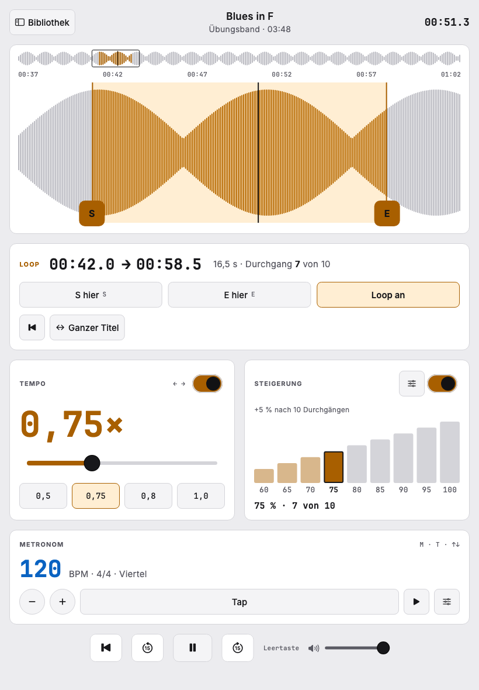

<div align="center">


# Woodshed Player

### Gezielter üben. Spielen, bis es sitzt.

**Der Übe-Player für Musikerinnen und Musiker.**<br>
Jedes Stück langsamer abspielen, ohne dass sich die Tonhöhe ändert, die schweren Takte im Loop üben, mit Metronom spielen und das Tempo steigen lassen, wenn es sitzt. Am Mac, unter Windows und Linux, auf iPhone und iPad und in jedem Browser. Kostenlos, quelloffen und von Grund auf privat.

[**▶ Web-App öffnen**](https://ingen63.github.io/Woodshed-Player/app/) · [**Version 1.0 für macOS, Windows und Linux laden**](https://github.com/ingen63/Woodshed-Player/releases) · [Was ist neu](CHANGELOG.md)

[](https://github.com/ingen63/Woodshed-Player/actions/workflows/test-quality.yml)
[](https://github.com/ingen63/Woodshed-Player/actions/workflows/pages.yml)
[](https://github.com/ingen63/Woodshed-Player/actions/workflows/release.yml)

[English](README.md) · **Deutsch**

</div>

<br>

<picture>
  <source media="(prefers-color-scheme: dark)" srcset="docs/screenshots/studio-desktop-dark.png">
  
</picture>

<table>
  <tr>
    <td width="62%">
      <picture>
        <source media="(prefers-color-scheme: dark)" srcset="docs/screenshots/studio-tablet-dark.png">
        
      </picture>
    </td>
    <td width="38%">
      <picture>
        <source media="(prefers-color-scheme: dark)" srcset="docs/screenshots/studio-phone-dark.png">
        
      </picture>
    </td>
  </tr>
</table>

<sub>Englische Oberfläche, erfundene Titel und eine erzeugte Wellenform. Die Screenshots folgen Deinem GitHub-Design (hell oder dunkel).</sub>

## Warum Woodshed Player?

*Woodshedding* nennen Musikerinnen und Musiker das Üben im stillen Kämmerlein: eine schwere Stelle immer wieder, bis sie sitzt. Genau für diesen Moment ist Woodshed Player gemacht: das Solo, das Du heraushörst, der Lauf, der noch zu schnell ist, der Groove, der sitzen soll.

- **Jeden Ton hören.** Die Musik im Schneckentempo abspielen, und sie klingt trotzdem nach sich selbst, in der richtigen Tonart.
- **Bei der schweren Stelle bleiben.** Die Takte einmal markieren; Loop, Tempo und Fortschritt sind auch morgen noch da.
- **Schneller werden, ohne daran zu denken.** Die Steigerung hebt das Tempo für Dich, Durchgang um Durchgang, bis Du es in vollem Tempo spielst.
- **Dich selbst hören.** Aufnahme scharf machen, spielen, und jede Aufnahme landet in der Bibliothek, bereit zum Anhören oder für den Loop.
- **Deine Musik bleibt Deine.** Kein Konto, keine Werbung, kein Tracking. Nichts verlässt Dein Gerät, ausser Du schaltest den Abgleich ein.

## Funktionen

### 🎧 Player und Üben

- 🐢 **Langsamer, gleiche Tonhöhe.** Tempo von 0,1× bis 2×, ohne dass sich die Tonart ändert, mit hochwertigem Time-Stretch in einem Audio-Kern in C++.
- 🔁 **Loops, die bleiben.** Die Marker **S** und **E** in der Wellenform ziehen, `mm:ss.d` eintippen oder während der Wiedergabe **S** / **E** drücken. Jeder Titel merkt sich seinen Loop und sein Tempo.
- 📈 **Steigerung.** Bei 60 % beginnen, alle 10 Durchgänge 5 % schneller, am Ende volles Tempo, ganz von selbst.
- 🥁 **Metronom.** 20–300 BPM, Tap-Tempo, 4/4, 3/4, 2/4 und 6/8, Unterteilungen bis zu Sechzehnteln und eine automatische Tempo-Steigerung nach Takten, Zeit oder Durchgängen.

### 🎙️ Aufnahme

- **Aufnehmen, was Du spielst.** Mikrofon am Mac und in der Web-App, Systemton am Mac, verlustfrei als FLAC mit 24 Bit. Jede Aufnahme landet direkt in der Bibliothek, bereit für den Loop.
- **Scharf.** In *Üben* oder *Metronom* einschalten und einfach spielen: Der erste Ton startet eine Aufnahme mit einer Sekunde Vorlauf, eine Pause beendet sie, abgelegt unter `Recordings › Datum`. Bleibt der Schalter scharf, wird jede Spielphase zu einer eigenen Aufnahme.

### 📚 Bibliothek

- Ordner mit beliebig tiefen Unterordnern, Playlists, Mehrfachauswahl, Ziehen und Ablegen, Sortierung.
- Jede Datei wird nur einmal gespeichert, erkannt an ihrem Inhalt. Anfang und Ende eines Titels abschneiden (WAV, FLAC, MP3, AAC, M4A).
- **MP3-Export am Mac** mit Titel, Artist und Jahr.

### ☁️ Abgleich, wenn Du willst

- Abgleich auf Wunsch über Dein eigenes Google Drive, nur mit den Dateien, die die App selbst anlegt. Ohne Konto verlässt nichts Dein Gerät.

### 🌗 Zum Üben gemacht

- Drei Bereiche: Player, Üben und Metronom, mit Layouts für Desktop, Tablet und Phone.
- Dunkel als Standard, hell, wann immer Du willst; am Mac folgt sogar die Titelleiste Deiner Wahl.
- Tastenkürzel überall (**?** zeigt die Übersicht) und eine eingebaute Hilfe, die auch offline geht.
- Deutsch und Englisch nach der Systemsprache, bis in die Menüleiste des Mac.

Alle Funktionen im Detail: [`docs/FUNKTIONEN.md`](docs/FUNKTIONEN.md).

## Neu in 1.0

Version 1.0 ist die erste stabile Version der neuen App: eine Oberfläche in Flutter auf einem Audio-Kern in C++, der am Mac, unter Windows und unter Linux nativ und im Browser als WebAssembly läuft. Das Wichtigste seit der ersten Vorschau:

- **Aufnahme in der Web-App,** mit dem Mikrofon und dem Schalter **Scharf**, auf iPhone, iPad, Android und dem Desktop.
- **Scharfe Aufnahme beim Üben,** jede Aufnahme nach Datum abgelegt.
- **Unterordner,** Hilfe-Seiten für jeden Bereich und eine Übersicht der Tastenkürzel.
- **Dunkel als Standard,** mit einer Titelleiste am Mac, die zur App passt.
- **Auf dem iPhone auch im Stumm-Modus hörbar,** wie eine Musik-App.
- **Native Apps für Windows und Linux** (x64), mit der Kommandozeile zum Abspielen.
- **MP3-Export und Kommandozeile** am Mac.

Die vollständige Liste steht in den [Release Notes](CHANGELOG.md).

## Plattformen

| | Wie | |
| --- | --- | --- |
| **macOS** 14+ | Native App, Apple Silicon und Intel | Aufnahme, MP3-Export und die volle Kommandozeile nur hier |
| **iPhone, iPad** | [Web-App](https://ingen63.github.io/Woodshed-Player/app/), auf den Home-Bildschirm installierbar | Läuft offline, Steuerung auf dem Sperrbildschirm, Aufnahme über das Mikrofon |
| **Android und alles andere** | [Web-App](https://ingen63.github.io/Woodshed-Player/app/) im Browser | Ohne Installation, ohne Konto, Aufnahme über das Mikrofon |
| **Windows** 10 (1803)+ und 11, x64 | Native App | Kommandozeile zum Abspielen, Abgleich über Google Drive; noch keine Aufnahme (in der Web-App) |
| **Linux**, x64 | Native App mit GTK 3 | Wie unter Windows |

## Installation

Die Pakete jeder Version liegen unter [Releases](https://github.com/ingen63/Woodshed-Player/releases), mit den Release Notes auf Englisch und Deutsch ([`CHANGELOG.en.md`](CHANGELOG.en.md), [`CHANGELOG.md`](CHANGELOG.md)). Jedes Paket enthält die Lizenz (`LICENSE`) und die Lizenztexte der Schriften und Kern-Bibliotheken (Ordner `Licenses` bzw. `licenses`).

| Paket | Plattform |
| --- | --- |
| `WoodshedPlayer-<Version>-macos.dmg` | macOS 14 oder neuer, Apple Silicon und Intel (Universal) |
| `WoodshedPlayer-<Version>-windows.zip` | Windows 10 (Version 1803) oder neuer und Windows 11, x64 |
| `WoodshedPlayer-<Version>-linux.tar.gz` | Linux, x64, mit GTK 3 |
| `WoodshedPlayer-<Version>-web.zip` | Web-App zum Selbst-Hosten, derselbe Stand wie unter <https://ingen63.github.io/Woodshed-Player/app/> |

- **macOS:** `.dmg` öffnen und *Woodshed Player* in den Ordner *Programme* ziehen. Die App ist nur ad hoc signiert und nicht notarisiert (es gibt kein Apple-Developer-Konto). Beim ersten Start darum im Finder **Rechtsklick › Öffnen** wählen und im Dialog nochmals *Öffnen*. Zeigt macOS nur «Nicht öffnen» oder «In den Papierkorb», unter *Systemeinstellungen › Datenschutz & Sicherheit* bei «Woodshed Player wurde blockiert» auf *Dennoch öffnen* klicken. Danach startet sie normal.
- **Windows:** Das `.zip` in einen beliebigen Ordner auspacken und im Ordner `WoodshedPlayer` die Datei `WoodshedPlayer.exe` starten. Die App ist nicht signiert, darum meldet Windows SmartScreen beim ersten Start «Der Computer wurde durch Windows geschützt»: auf **Weitere Informationen › Trotzdem ausführen** klicken. Die Bibliothek liegt in `%LOCALAPPDATA%\WoodshedPlayer`.
- **Linux:** Mit `tar -xzf WoodshedPlayer-<Version>-linux.tar.gz` auspacken und `WoodshedPlayer/woodshed-player` starten. Nötig sind GTK 3 und PulseAudio oder ALSA des Systems (nicht im Paket, siehe `licenses/SYSTEM-LIBRARIES.txt`); unter Debian und Ubuntu: `sudo apt install libgtk-3-0 libpulse0`. Der Abgleich mit Google Drive braucht zudem libsecret (`libsecret-1-0`), das die Anmeldung im Schlüsselbund des Desktops ablegt. Die Bibliothek liegt in `~/.local/share/WoodshedPlayer`.
- **Web-App:** Nichts zu installieren, einfach <https://ingen63.github.io/Woodshed-Player/app/> öffnen. Zum Selbst-Hosten den Ordner aus dem `.zip` an die Wurzel eines Webservers mit HTTPS legen (oder lokal über `localhost` ausliefern). Die App läuft nur an der Wurzel (`/`), nicht in einem Unterordner.

## Kommandozeile

Die App ist zugleich eine Kommandozeile: einen Titel der Bibliothek abspielen oder (am Mac) eine Aufnahme scharf machen, die mit dem ersten Ton beginnt und nach einer Pause von selbst endet. So landet ein Stück, das im Browser läuft, ohne Stille am Anfang und Ende in der Bibliothek.

```bash
cp tools/woodshed ~/bin/woodshed          # ein beliebiger Ordner im PATH
woodshed play --title "Blue Practice" --artist "Test Band"
woodshed record --title "Blue Practice" --artist "Test Band" --year 1937
woodshed --help
```

Unter Windows heisst der Befehl im Ordner der App `WoodshedPlayer play --title "Blue Practice"` (`WoodshedPlayer.com`, das die Shell vor der `.exe` findet), unter Linux `./woodshed-player play --title "Blue Practice"`; `record` meldet dort «not supported».

Der Befehl spricht nur mit der App auf demselben Rechner, über eine Socket-Datei, nie über das Netzwerk. Details: [`docs/FUNKTIONEN.md`](docs/FUNKTIONEN.md) (Zeile «Kommandozeile»).

## Datenschutz

Woodshed Player arbeitet **lokal**.

- Kein Konto nötig, keine Werbung, keine Analyse, kein Tracking.
- Keine Netzwerkverbindung, ausser für den Abgleich, den Du selbst wählst (Google Drive nach der Anmeldung oder Deine eigenen gekoppelten Geräte), und das Laden der Web-App.
- Deine Musik und Deine Bibliothek bleiben im privaten Ordner der App, bei der Web-App im privaten Speicher des Browsers.
- Das Mikrofon nutzt die App nur, während Du damit aufnimmst oder **Scharf** an ist; Aufnahmen bleiben auf Deinem Gerät (in der Web-App im Speicher des Browsers) und verlassen es nur mit dem gewählten Abgleich.
- Eine automatische Prüfung bei jedem Push stellt sicher, dass nur der Code für den Abgleich Verbindungen öffnen darf.

Datenschutzerklärung: <https://ingen63.github.io/Woodshed-Player/datenschutz.html> · Nutzungsbedingungen: <https://ingen63.github.io/Woodshed-Player/nutzungsbedingungen.html> · Alle Details: [`docs/FUNKTIONEN.md`](docs/FUNKTIONEN.md#datenschutz-im-detail)

## Unter der Haube

- **App:** [Flutter](https://flutter.dev) für macOS, iOS, Windows, Linux und das Web, in [`app/`](app/).
- **Audio-Kern:** C++17 in [`core/`](core/) mit C-API, mit [miniaudio](https://miniaud.io), [Signalsmith Stretch](https://signalsmith-audio.co.uk/code/stretch/) und libFLAC. Nativ über `dart:ffi`, im Browser als WebAssembly in einem AudioWorklet.
- **Gründlich getestet:** Unit- und Oberflächentests, Sanitizer, Untergrenzen für die Abdeckung, Mutationstests und eine Prüfung, dass sich der WASM-Kern genau wie der native verhält. Siehe [`docs/TESTS.md`](docs/TESTS.md).
- **Ältere Version:** Die ursprüngliche SwiftUI-App liegt weiter in [`WoodshedPlayer/`](WoodshedPlayer/).

## Mitarbeit

Anforderungen kommen aus [GitHub Issues](https://github.com/ingen63/Woodshed-Player/issues), jedes mit Abnahmekriterien als Häkchen-Liste. Bauen, Testen, die Technik im Detail und den Release-Ablauf beschreibt [`docs/ENTWICKLUNG.md`](docs/ENTWICKLUNG.md), die Arbeitsregeln stehen in [`CLAUDE.md`](CLAUDE.md). Sicherheitslücken bitte wie in [`SECURITY.md`](SECURITY.md) beschrieben melden.

## Lizenz

Der Quellcode und das App-Icon ([Quelle](app/assets/icons/README.md)) stehen unter der [MIT-Lizenz](LICENSE). Der Name «Woodshed Player» ist davon nicht umfasst.

Die Schriften Inter und JetBrains Mono stehen unter der [SIL Open Font License 1.1](app/assets/fonts/README.md). Der Audio-Kern enthält miniaudio (Public Domain oder MIT-0), Signalsmith Stretch und Signalsmith Linear (MIT) sowie libFLAC (BSD-3-Clause). Der MP3-Export am Mac lädt **LAME** (LGPL) als eigene, austauschbare Bibliothek. Versionen, Quellen und Lizenztexte: [`docs/ENTWICKLUNG.md`](docs/ENTWICKLUNG.md#lizenzen-im-detail) und in der App unter *Über Woodshed Player › Lizenzen ansehen*.
