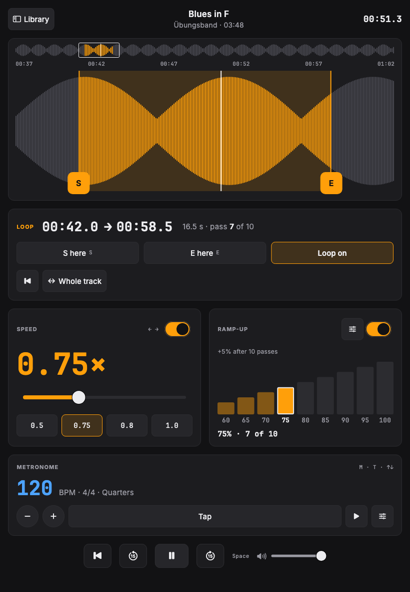

# Woodshed Player

Native SwiftUI-App für **macOS 14+** und **iOS/iPadOS 17+** aus einer gemeinsamen Codebasis.

## Starten

1. **Xcode** aus dem Mac App Store installieren (Version 16 oder neuer) und einmal öffnen.
2. `WoodshedPlayer.xcodeproj` öffnen.
3. Target *WoodshedPlayer* → *Signing & Capabilities* → unter *Team* deine Apple-ID wählen.
   Falls die Bundle-ID `ch.woodshed-player-app.legacy` schon vergeben ist, dort ändern.
4. Oben in der Leiste als Ziel **My Mac** oder einen iPhone-Simulator/dein iPhone wählen → **⌘R**.

## Funktionen

| Funktion | Bedienung |
| --- | --- |
| MP3 hinzufügen | **+** in der Symbolleiste (⌘O), auf dem Mac auch Dateien in die Liste ziehen |
| MP3 löschen | Rechtsklick → *Löschen*, auf dem Mac auch Entf-Taste, auf iOS wischen oder *Bearbeiten* |
| Ordner | Ordner-Symbol in der Symbolleiste (⇧⌘N) legt einen Ordner an. Titel mit der Maus auf einen Ordner (oder zwischen dessen Titel) ziehen oder per Rechtsklick → *In Ordner verschieben*. Rechtsklick auf einen Ordner: *MP3 hinzufügen*, *Umbenennen*, *Ordner löschen* (die Titel bleiben erhalten) |
| Sortierung | Pfeil-Symbol → *Alphabetisch*, *Hinzugefügt* (neueste zuerst), *Eigene Reihenfolge* |
| Eigene Reihenfolge | Titel innerhalb eines Ordners mit der Maus (bzw. dem Finger) verschieben, die Sortierung wechselt dann automatisch auf *Eigene Reihenfolge* |
| Abspielen | Play/Pause (**Leertaste**), ±15 s, Fortschrittsbalken zum Springen, Lautstärke. Stoppt man mit der Leertaste bei aktivem Loop, springt die Position zum Loop-Anfang zurück |
| Geschwindigkeit | Schalter *Geschwindigkeit*, Regler 0,1× – 2× in 0,05er-Schritten, Pfeiltasten **←** / **→**, Schnellwahl 0,5× / 0,7× / 0,8× / 0,9× / 1,0× / 1,1×. Die Tonhöhe bleibt gleich |
| Loop | Schalter *Loop*, Anfang/Ende als `mm:ss` (z. B. `01:23` – `02:11`), per *Aktuelle Position*, mit den Tasten **S** (Anfang) / **E** (Ende) oder durch Ziehen der orangen Marker im Fortschrittsbalken (die Zeitfelder zeigen dabei live die Position). Das Ende liegt immer mindestens 1 s nach dem Anfang |

Geschwindigkeit und Loop werden **pro Datei** gespeichert und beim nächsten Öffnen wiederhergestellt.

### Flutter-App (im Umbau, `app/`)

Die neue App für alle Plattformen (Plan: `docs/UMBAUPLAN-FLUTTER.md`) hat dieselbe Bibliothek wie die bisherige App und das Design «Studio» (Mockups in `docs/design/`): Wellenform mit Loop-Bereich im Zentrum, Loop und Tempo grösser als Play/Pause, Zahlen in JetBrains Mono mit gleich breiten Ziffern, Text in Inter. Hell oder Dunkel ist im Kopf der Bibliothek wählbar, Standard ist die Systemeinstellung.

| Desktop (> 1000 px) | Tablet (600–1000 px) | Phone (< 600 px) |
| --- | --- | --- |
|  |  |  |
|  |  |  |

Die Screenshots zeigen erfundene Titel und eine erzeugte Wellenform (`cd app && flutter test tool/screenshots_test.dart --update-goldens`).

| Funktion | Bedienung |
| --- | --- |
| Grössen | Das Layout richtet sich nach der Fensterbreite und wechselt ohne Unterbruch von Wiedergabe oder Loop. **Desktop:** Bibliothek fest links, darunter Wellenform, Loop-Leiste und die Module Tempo, Steigerung und Metronom nebeneinander. **Tablet:** Bibliothek über den Knopf «Bibliothek» einblendbar, Module zweispaltig. **Phone:** Bibliothek als eigene Seite (Leiste unten öffnet den Übe-Bildschirm, «‹» führt zurück), einspaltig, *S hier* / Play / *E hier* unten in Daumenreichweite. Auf Tablet und Phone sind alle Bedienelemente mindestens 44 × 44 pt (iOS) bzw. 48 × 48 dp (Android) gross |
| Wellenform | Oben die Übersicht des ganzen Titels (Tippen springt, der Rahmen zeigt den Ausschnitt), darunter der Ausschnitt um den Loop bzw. die 30 Sekunden um die Wiedergabeposition, mit Zeitachse und Playhead. Solange keine Wellenform da ist, erscheint ein schlichter Fortschrittsbalken |
| Loop | Leiste «LOOP» mit «Anfang → Ende» als `mm:ss.d` (beide Zeiten lassen sich eintippen), Länge und Durchgangszähler, *S hier* / *E hier* (Tasten **S** / **E**), *Zum Loop-Anfang*, *Ganzer Titel* und *Loop an/aus*. Die Marker **S** und **E** in der Wellenform lassen sich ziehen |
| Tempo | Grösste Zahl auf dem Bildschirm, Schalter, Regler 0,1× – 2× und Schnellwahl 0,5 / 0,75 / 0,8 / 1,0; Pfeiltasten **←** / **→**. Die Tonhöhe bleibt gleich |
| Kürzel-Badges | Neben den Knöpfen stehen die Tastenkürzel, aber nur, wenn eine Tastatur da ist (am iPad, sobald eine Taste gedrückt wurde): ⌘ auf macOS und iPad, Ctrl auf Windows und Linux |

| Funktion | Bedienung |
| --- | --- |
| Bibliothek | Titel per **⌘O** / «+» wählen (mehrere) oder ins Fenster ziehen; Ordner (**⇧⌘N**), Sortierung, Titel per Ziehen (am iPhone: lange drücken) in Ordner verschieben, Kontextmenü (Rechtsklick oder «⋯») mit *Titel und Artist bearbeiten* (#24: nur in der Bibliothek, Audiodatei und Tags bleiben unverändert, leerer Titel nicht möglich), *In Ordner verschieben* und *Löschen* mit Rückfrage. Der erste importierte Titel wird geladen. Fertige Aufnahmen landen ebenfalls hier. Jede Zeile zeigt Dauer, gespeicherten Loop als Balken und das Tempo. Ein Titel wird über den SHA-256 seines Inhalts erkannt: dieselbe Datei wird nur einmal gespeichert. Im Fuss steht der Speicherverbrauch (im Browser auch der freie Platz und ob der Speicher dauerhaft ist) |
| Metronom | Start/Stopp mit **M**, Tempo 20–300 BPM mit −/+ (gedrückt halten wiederholt), Regler oder **↑** / **↓** (mit Shift ±10), Tap-Tempo mit **T**. Taktarten 4/4, 3/4, 2/4, 6/8, Unterteilungen Viertel bis Sechzehntel, eigene Lautstärke. Modul «Metronom» mit BPM in Blau, −/+, Tap und Start/Stopp; alle Einstellungen über das Regler-Symbol (Dialog, am Phone von unten). Titel und Metronom laufen nie gleichzeitig (Start des einen pausiert den anderen). Nach einem Neustart gilt 120 BPM, die übrigen Einstellungen bleiben erhalten |
| Automatische Tempo-Steigerung | Wahlweise nach «Takte» oder «Zeit». Takte: Start- und Ziel-BPM, Schritt und alle wie viele Takte; ist das Ziel erreicht, geht es nach gleich vielen Takten wieder beim Start-BPM los. Zeit: Start- und Ziel-BPM und Dauer (1–60 Minuten, Standard 4); das Tempo ändert sich in 1-BPM-Schritten gleichmässig über die Dauer, jeweils am Taktanfang, bleibt nach Erreichen des Ziels einen Schritt lang und beginnt dann wieder beim Start-BPM |
| Steigerung nach Durchgängen | Modul «Steigerung» mit Stufenleiter (erreichte Stufen gedämpft, aktuelle umrandet), die Einstellungen öffnet das Regler-Symbol. Die Geschwindigkeit des Titels steigt stufenweise mit der Zahl der Loop-Durchgänge, einstellbar sind Start- und Zielstufe, Schrittweite (+1 bis +20 %) und Durchgänge pro Stufe (Standard 60 % → 100 %, +5 % alle 10 Durchgänge). Ein Durchgang zählt, wenn die Wiedergabe vom Loop-Ende zum Anfang springt, Springen von Hand nicht. Angezeigt werden Stufe und Durchgänge, z. B. «75 % · 7 von 10»; am Ziel bleibt die Geschwindigkeit, der Zähler läuft weiter. Loop-Grenzen oder Geschwindigkeit von Hand ändern setzt den Zähler auf 0. Gespeichert pro Titel |
| Gerätewechsel | Wird die Ausgabe gewechselt (z. B. Kopfhörer ab) oder kommt ein Anruf dazwischen, pausieren Titel und Metronom; die Position bleibt. Weiter geht es mit Play |
| Aufnahme (nur Mac, ab macOS 14.2) | Knopf «Aufnahme» oben rechts (auf iPhone/iPad und Android nie sichtbar). Nimmt den Systemton auf, ohne Mikrofon und ohne den eigenen Player-Ton. Beim ersten Mal fragt macOS nach der Berechtigung |
| Darstellung | Knopf im Kopf der Bibliothek (Symbol Auto, Sonne oder Mond) mit *System*, *Hell* und *Dunkel*, auch im Phone-Layout. *Hell* und *Dunkel* gelten sofort und unabhängig von der Systemeinstellung, *System* folgt ihr auch bei laufender App. Die Wahl ist wie die Sortierung eine geteilte Einstellung in `library.json` und bleibt nach einem Neustart erhalten; fehlt sie oder ist sie unlesbar, gilt *System* |
| Bibliothek und Datenformat (#36) | `library.json` hat ab Format 2 eine Versionsnummer, je geteiltem Feld einen Änderungsstempel (Zeit, Zähler, Gerät-ID) und hält gelöschte Titel und Ordner 90 Tage als Grabstein, damit sich später Änderungen mehrerer Geräte zusammenführen lassen (#37). Eine ältere Bibliothek wird beim ersten Start überführt: Titel-ID wird der SHA-256 der Audiodatei, die Dateien in `Tracks/` heissen danach `<hash>.<ext>`, Loops, Tempo, Ordner und Einstellungen bleiben erhalten. Die alte Datei bleibt als `library.v1.json`, die Zuordnung alte ID → Hash als `library.v1-ids.json`. Danach kann das Swift-Altprojekt die Bibliothek **nicht mehr öffnen**. Ist `library.json` von einer neueren App-Version, bleibt sie unverändert und die App bittet, sich zu aktualisieren |
| Abgleich zwischen Geräten (#37) | Die Sync-Engine gleicht Bibliothek, geteilte Einstellungen und Audiodateien mit einem Cloudspeicher ab, sobald ein Konto verbunden ist (Anbieter und Anmeldung folgen mit #38/#40). **Ohne Konto bleibt alles lokal.** Zusammengeführt wird je Feld (jüngere Änderung gewinnt), Loops einzeln über ihre Loop-ID, gelöschte Titel und Ordner über Grabsteine. Abgeglichen wird beim Start, bei der Rückkehr in den Vordergrund und kurz nach einer Änderung; ohne Verbindung warten die Änderungen und gehen später mit wachsendem Abstand erneut raus, eine Datei, die mehrmals scheitert, wird nicht endlos wiederholt. Im Kontextmenü: *Nicht hochladen* (Titel) und *Synchronisieren* (Ordner, Standard an); die Audiodatei bleibt dann auf dem Gerät, Titel, Loops und Tempo wandern trotzdem mit. Auf anderen Geräten steht solch ein Titel mit «Datei nur auf einem Gerät». Am Desktop kommen Audiodateien gleich mit, auf Handy und im Browser erst beim Abspielen. In der Cloud liegen `state.json`, die letzten 5 Stände unter `backup/` und die Audiodateien als `audio/<hash>.<ext>` |
| Sprache | Die Oberfläche folgt der Systemsprache: Deutsch oder Englisch, bei jeder anderen Sprache Englisch. Zahlen und Grössen stehen in der Schreibweise der Sprache (z. B. «0,75×» und «1,2 GB» auf Deutsch, «0.75×» und «1.2 GB» auf Englisch); Zeiten `mm:ss` sind überall gleich |

## Technik

- `Audio/AudioPlayer.swift`: `AVAudioEngine` → `AVAudioPlayerNode` → `AVAudioUnitTimePitch`.
  Die Geschwindigkeit ändert sich ohne Tonhöhenänderung. Loops werden als sich wiederholende Segmente geplant (lückenlos).
- `Model/Library.swift`: Importierte Dateien werden in den App-Ordner kopiert (*Application Support/WoodshedPlayer*).
  Metadaten und Einstellungen liegen in `library.json`.
- `Views/PlayerKeyboardShortcuts.swift`: Tastatursteuerung. Beim Tippen in Textfeldern ist sie aus.
- `Views/`: SwiftUI-Oberfläche, angelehnt an die macOS-Schnellansicht.
- `WoodshedPlayerTests/`: Tests (Swift Testing) für Zeitformat, Loop-Grenzen und `library.json`. Testaudio wird im Test erzeugt.
  Ausführen mit ⌘U in Xcode oder `xcodebuild -project WoodshedPlayer.xcodeproj -scheme WoodshedPlayer -destination 'platform=macOS' test`.
- Auf iOS läuft die Wiedergabe auch im Hintergrund weiter (Background Mode *Audio*).
- `core/` (Flutter-App): Audio-Kern in C++ mit C-API `core/include/wp_core.h` (miniaudio, Signalsmith Stretch).
  Steuerbefehle erreichen den Audio-Thread über eine Lock-free-Queue, Titel werden im Hintergrund dekodiert,
  Ladefehler kommen mit Code und Text (`wp_error_message`). Tests mit `ctest`, Testaudio aus `core/tools/make_test_audio.sh`.
- `app/` (Flutter-App): `lib/library/` (`library.json` im Format 2 mit Stempeln, `stamps.dart` mit Zusammenführen je Feld, `migration.dart` für das alte Swift-kompatible Format, eigener Metadaten-Leser für ID3/FLAC/WAV), `lib/player/` (Player-Service über FFI), `lib/app/` (Zusammenspiel, Dateiauswahl), `lib/ui/`. Rauchtest mit echtem Kern: `cd app && flutter test integration_test -d macos`.
- `core/web/`: Kern fürs Web (#33): `emcmake cmake -S core -B core/build-wasm` baut `wp_core_web.wasm` fürs AudioWorklet (C-API wie `wp_core.h`, ergänzt um `wp_core_web.h`) und lässt dieselben `ctest`-Fälle unter Node.js laufen. MP3, WAV und FLAC dekodiert der Kern, AAC/M4A der Browser (`decodeAudioData`). JS-Hülle `wp_core_web.mjs`, Worklet `wp_worklet.js`, Worker `wp_loader.js` (#42: dekodiert mit einer zweiten Instanz des Kerns, damit Wiedergabe und Metronom beim Laden nicht aussetzen), Browser-Test `browser_test.html`.
- Flutter-App im Browser (#34): `AudioCore` hat zwei Implementierungen, per bedingtem Import gewählt: FFI auf Desktop und Handy, im Browser der WASM-Kern im AudioWorklet (`app/lib/player/audio_core_web.dart`, Steuerung und Zustand als Nachrichten). Bau: `app/tool/build_web_core.sh`, dann `cd app && flutter build web`. Prüfung im Browser: `app/tool/web_core_check.sh` (misst Position, Pegel, Wellenform, Tempo, Loop, Seek, Metronom, dazu #42: Laden ohne Aussetzer, Formate, Dauer in der Bibliothek).
- Speicher-Schicht (#35): `FileStore` in `app/lib/app/file_platform.dart`, im Dateisystem (`file_store_io.dart`, Desktop und Handy) und im Origin Private File System des Browsers (`file_store_web.dart`). Seit #36 ist der SHA-256 die Titel-ID; dieselbe Migration läuft im Dateisystem und im Browser. Prüfung im Browser: `app/tool/web_store_check.sh`.
- Sprachen (#43): Alle Oberflächentexte stehen in `app/lib/l10n/app_en.arb` (Vorlage, Englisch) und `app_de.arb`; Flutter `gen-l10n` erzeugt daraus `AppLocalizations` (Einstellungen in `app/l10n.yaml`). Eine weitere Sprache braucht nur eine zusätzliche Datei `app_<code>.arb`. Ein Test prüft, dass jeder Schlüssel in allen Dateien vorkommt.
- `web/w0/`: Machbarkeitstest für die Web-App (#32): Engine und Metronom als WebAssembly im AudioWorklet (`core/web/build_w0.sh`, Prüfung mit `node core/web/w0_test.mjs`). Ergebnis in `docs/PLAN-WEB-UND-SYNC.md`.

## Datenschutz

Woodshed Player arbeitet **vollständig lokal**:

- Keine Netzwerkverbindungen, kein Konto, keine Werbung.
- Keine Analyse- oder Tracking-Dienste, keine Weitergabe von Daten an Dritte.
- Importierte MP3-Dateien werden in den privaten App-Ordner kopiert. Titel, Künstler, Album, Cover sowie Tempo- und Loop-Einstellungen werden nur dort (`library.json`) und in den lokalen App-Einstellungen gespeichert.
- Die App läuft in der macOS-App-Sandbox und liest nur Dateien, die du selbst auswählst.
- Flutter-App: Geteilte Einstellungen (Sortierung, Darstellung, Metronom- und Steigerungs-Voreinstellungen) liegen mit der Bibliothek in `library.json`, ein früheres `metronome.json` wird einmal übernommen. Gerätelokal ist `device.json` mit einer zufälligen Gerät-ID (keine Hardware-Kennung); sie steht in den Änderungsstempeln und verlässt das Gerät nur mit dem Cloud-Sync. Dateipfade werden nicht gespeichert. Aufnahmen des Systemtons (Mac) werden nur lokal im App-Ordner gespeichert; die Aufnahme startet nur auf Knopfdruck.
- Cloud-Sync (#37): **ohne Konto keine Verbindung.** Ohne Konto benutzt die App `NoSync`, sendet keine Anfrage und lädt kein Anbieter-Modul. Erst nach ausdrücklicher Anmeldung (ab #38/#40) gehen `state.json` (Bibliothek, Loops, Tempo, geteilte Einstellungen mit Gerät-ID in den Stempeln) und die Audiodateien in den app-eigenen Ordner des gewählten Anbieters, an keine anderen Stellen. Titel mit *Nicht hochladen* und Titel in Ordnern ohne *Synchronisieren* bleiben als Datei auf dem Gerät, ihre Metadaten (Titel, Artist, Loops) wandern trotzdem mit.
- Löschst du die App (und ihren Datenordner), sind alle gespeicherten Daten weg.
- Flutter-App im Browser (#34, #35): lädt alles von der eigenen Seite (auch CanvasKit, keine Schriften von Google). Gewählte Audiodateien und die Bibliothek liegen im privaten Speicher der Seite im Browser (Origin Private File System) und verlassen das Gerät nicht. Die App bittet den Browser um dauerhaften Speicher (`navigator.storage.persist()`), damit er die Bibliothek nicht von sich aus löscht; «Websitedaten löschen» entfernt sie trotzdem.
- Testseite W0 (`web/w0/`): lädt nur ihre eigenen Dateien, sendet nichts; gewählte Audiodateien und die OPFS-Testdaten bleiben im Browser des Geräts. Beim Laden der Seite sieht der Webhost (GitHub Pages) die IP-Adresse.

## Lizenz

Der Quellcode steht unter der [MIT-Lizenz](LICENSE). Der Name „Woodshed Player“ und das App-Icon sind davon nicht umfasst.

Die mitgelieferten Schriften Inter und JetBrains Mono stehen unter der [SIL Open Font License 1.1](app/assets/fonts/README.md) (Lizenztexte und Quellen dort, in der App unter «Lizenzen»).
