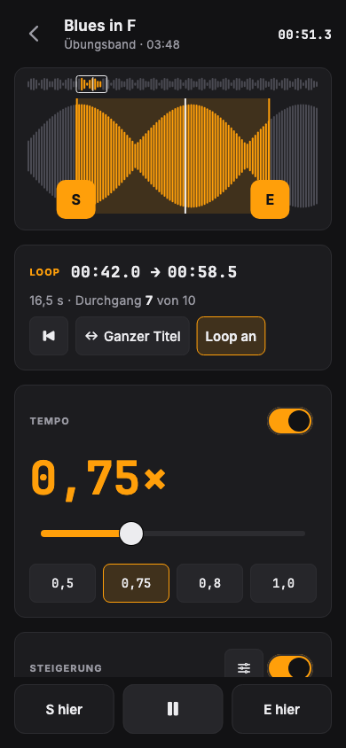

# Woodshed Player

Native SwiftUI-App für **macOS 14+** und **iOS/iPadOS 17+** aus einer gemeinsamen Codebasis.

## Installation

Die Pakete jeder Version liegen unter [Releases](https://github.com/ingen63/Woodshed-Player/releases), mit den Release Notes auf Englisch und Deutsch ([`CHANGELOG.en.md`](CHANGELOG.en.md), [`CHANGELOG.md`](CHANGELOG.md)). Jedes Paket enthält die Lizenz (`LICENSE`) und die Lizenztexte der Schriften und Kern-Bibliotheken (Ordner `Licenses` bzw. `licenses`).

| Paket | Plattform |
| --- | --- |
| `WoodshedPlayer-<Version>-macos.dmg` | macOS 14 oder neuer, Apple Silicon und Intel (Universal) |
| `WoodshedPlayer-<Version>-web.zip` | Web-App zum Selbst-Hosten, derselbe Stand wie unter <https://ingen63.github.io/Woodshed-Player/app/> |

Windows und Linux folgen mit #60. Auf iPhone und iPad läuft die Web-App.

- **macOS:** `.dmg` öffnen und *Woodshed Player* in den Ordner *Programme* ziehen. Die App ist nur ad hoc signiert und nicht notarisiert (es gibt kein Apple-Developer-Konto). Beim ersten Start darum im Finder **Rechtsklick › Öffnen** wählen und im Dialog nochmals *Öffnen*. Zeigt macOS nur «Nicht öffnen» oder «In den Papierkorb», unter *Systemeinstellungen › Datenschutz & Sicherheit* bei «Woodshed Player wurde blockiert» auf *Dennoch öffnen* klicken. Danach startet sie normal.
- **Web-App:** Den Ordner aus dem `.zip` an die Wurzel eines Webservers mit HTTPS legen (oder lokal über `localhost` ausliefern). Die App läuft nur an der Wurzel (`/`), nicht in einem Unterordner.

## Release

Ein Tag `v*` startet [`.github/workflows/release.yml`](.github/workflows/release.yml) (#139): Er prüft die Release Notes, baut das macOS-Paket und die Web-App und legt einen **Entwurf** unter *Releases* an. Fehlt die Version in einer Sprache oder schlägt ein Paket fehl, entsteht kein Entwurf; der rote Lauf nennt Sprache bzw. Plattform.

1. **Version setzen:** `version` in `app/pubspec.yaml` und `appVersion` in `app/lib/app/app_info.dart`, z. B. `0.9.0`.
2. **Eintrag schreiben:** in `CHANGELOG.md` oben `## Version 0.9.0` mit den Abschnitten `### Neu, geändert, behoben` und `### Tests und Entwicklung` (mindestens einer, in dieser Reihenfolge); jeder Punkt nennt seine Issues (`#123`). Eine Einleitung vor dem ersten Abschnitt ist erlaubt.
3. **Übersetzen:** denselben Eintrag in `CHANGELOG.en.md` mit `### New, changed, fixed` und `### Tests and development`, dieselben Issue-Nummern je Abschnitt.
4. **Prüfen:** `make test-changelog` (läuft auch in `make test` und in CI); `python3 tools/changelog.py notes v0.9.0` zeigt den Text des Entwurfs (Englisch offen, Deutsch aufklappbar), `python3 tools/changelog.py tag v0.9.0` prüft, dass der Tag zur App-Version passt.
5. **Tag setzen und pushen:** `git tag v0.9.0` und `git push origin v0.9.0`. Der Entwurf heisst «Woodshed Player 0.9.0».
6. **Veröffentlichen:** unter *Releases* den Entwurf prüfen und *Publish release* klicken (**Publish**).

Lokal baut `make package` die Pakete des letzten Tags nach `local/release/`, aus den zuvor gebauten Apps (`flutter build macos --release`; `flutter build web --release --base-href / --dart-define=WP_GIT_TAG=<Tag>`), und prüft Version, Tag, Universal-Binärdateien und Signatur. Die Web-App unter GitHub Pages veröffentlicht weiterhin `pages.yml` beim selben Tag.

## Starten

1. **Xcode** aus dem Mac App Store installieren (Version 16 oder neuer) und einmal öffnen.
2. `WoodshedPlayer.xcodeproj` öffnen.
3. Target *WoodshedPlayer* → *Signing & Capabilities* → unter *Team* deine Apple-ID wählen.
   Falls die Bundle-ID `ch.woodshed-player-app.legacy` schon vergeben ist, dort ändern.
4. Oben in der Leiste als Ziel **My Mac** oder einen iPhone-Simulator/dein iPhone wählen → **⌘R**.

## Funktionen

| Funktion | Bedienung |
| --- | --- |
| MP3 hinzufügen | **+** in der Symbolleiste (⌘O), auf dem Mac auch Dateien in die Liste ziehen |
| MP3 löschen | Rechtsklick → *Löschen*, auf dem Mac auch Entf-Taste, auf iOS wischen oder *Bearbeiten* |
| Ordner | Ordner-Symbol in der Symbolleiste (⇧⌘N) legt einen Ordner an. Titel mit der Maus auf einen Ordner (oder zwischen dessen Titel) ziehen oder per Rechtsklick → *In Ordner verschieben*. Rechtsklick auf einen Ordner: *MP3 hinzufügen*, *Umbenennen*, *Ordner löschen* (die Titel bleiben erhalten) |
| Sortierung | Pfeil-Symbol → *Alphabetisch*, *Hinzugefügt* (neueste zuerst), *Eigene Reihenfolge* |
| Eigene Reihenfolge | Titel innerhalb eines Ordners mit der Maus (bzw. dem Finger) verschieben, die Sortierung wechselt dann automatisch auf *Eigene Reihenfolge* |
| Abspielen | Play/Pause (**Leertaste**), ±15 s, Fortschrittsbalken zum Springen, Lautstärke. Stoppt man mit der Leertaste bei aktivem Loop, springt die Position zum Loop-Anfang zurück |
| Geschwindigkeit | Schalter *Geschwindigkeit*, Regler 0,1× – 2× in 0,05er-Schritten, Pfeiltasten **←** / **→**, Schnellwahl 0,5× / 0,7× / 0,8× / 0,9× / 1,0× / 1,1×. Die Tonhöhe bleibt gleich |
| Loop | Schalter *Loop*, Anfang/Ende als `mm:ss` (z. B. `01:23` – `02:11`), per *Aktuelle Position*, mit den Tasten **S** (Anfang) / **E** (Ende) oder durch Ziehen der orangen Marker im Fortschrittsbalken (die Zeitfelder zeigen dabei live die Position). Das Ende liegt immer mindestens 1 s nach dem Anfang |

Geschwindigkeit und Loop werden **pro Datei** gespeichert und beim nächsten Öffnen wiederhergestellt.

### Flutter-App (im Umbau, `app/`)

Die neue App für alle Plattformen (Plan: `docs/UMBAUPLAN-FLUTTER.md`) hat dieselbe Bibliothek wie die bisherige App und das Design «Studio» (Mockups in `docs/design/`): Wellenform mit Loop-Bereich im Zentrum, Loop und Tempo grösser als Play/Pause, Zahlen in JetBrains Mono mit gleich breiten Ziffern, Text in Inter. Hell oder Dunkel ist im Menü «⋯» im Kopf der Bibliothek wählbar, Standard ist die Systemeinstellung.

| Desktop (> 1000 px) | Tablet (600–1000 px) | Phone (< 600 px) |
| --- | --- | --- |
|  |  |  |
|  |  |  |

Die Screenshots zeigen die englische Oberfläche mit erfundenen Titeln und einer erzeugten Wellenform; sie entstehen unabhängig von der Systemsprache (`cd app && flutter test tool/screenshots_test.dart --update-goldens`).

| Funktion | Bedienung |
| --- | --- |
| Plattformen | **macOS, Windows, Linux:** native Flutter-App (Windows und Linux folgen). **iPhone/iPad:** native App und Web-App. **Android und alle anderen Geräte:** Web-App im Browser, ohne Installation und ohne Konto; eine native Android-App gibt es nicht. Die Aufnahme gibt es nur am Mac |
| Web-App (#41) | <https://ingen63.github.io/Woodshed-Player/app/>, auch über «App öffnen» auf der Startseite. Gehostet auf **GitHub Pages**; eine GitHub-Action baut sie aus dem letzten Git-Tag (vorher laufen die Tests), neue App-Stände erscheinen also nur mit einem neuen Tag. Ein Service Worker setzt die Header COOP/COEP, damit der Browser die Seite isoliert und `SharedArrayBuffer` bereitstellt |
| Web-App am Handy (#39) | **Installierbar** (Manifest und Icons): auf dem iPhone/iPad über *Teilen › Zum Home-Bildschirm*, worauf ein schliessbarer Hinweis oben hinweist, solange die App im Browser läuft; einmal geschlossen, bleibt er auf diesem Gerät und in diesem Browser weg (#110); auf Android über das Menü des Browsers. **Startet offline:** Der Service Worker legt die App beim ersten Besuch in den Cache; ein neuer Stand ersetzt den alten Cache beim nächsten Start mit Verbindung. **Sperrbildschirm und Kopfhörertasten** (Media Session): Titel und Artist, Abspielen, Pause, Springen (±15 s) und Position. **Bildschirm bleibt an** (#109, Screen Wake Lock, in jedem Browser, der sie kennt): Solange ein Titel spielt, geht der Bildschirm nicht aus; bei Pause, Stopp und Titelende gilt wieder die Sperrzeit des Geräts. Nach der Rückkehr aus dem Hintergrund bei laufender Wiedergabe gilt die Sperre wieder; ohne die Schnittstelle spielt die App wie bisher. Der Aufnahme-Knopf ist im Browser nie sichtbar. **Audio-Cache** (mit Abgleich): Die Audiodateien auf dem Gerät haben eine Obergrenze (Standard 2 GB, nur für dieses Gerät); Tippen auf die Speicherzeile im Fuss der Bibliothek stellt sie ein. Darüber verlieren die am längsten nicht gespielten Titel ihre Datei auf dem Gerät, sofern sie in der Cloud liegt; sie bleiben in der Bibliothek, stehen mit «Nur in der Cloud» in der Liste und werden beim Abspielen wieder geladen. *Offline halten* im Kontextmenü schützt einen Titel davor, ebenso der gerade geladene |
| Bereiche (#115) | Drei Bereiche: **Player** (Bibliothek mit Ordnern und Playlists, einfache Wiedergabe), **Üben** (Wellenform, Loop, Tempo und Steigerung) und **Metronom** (eigenständig, mit allen Einstellungen). Gewechselt wird über den Schalter «Player \| Üben \| Metronom» (Desktop in der Titelleiste, Tablet oben) oder die Tab-Leiste unten am Phone, am Desktop auch mit **⌘1**, **⌘2**, **⌘3** (Ctrl ausserhalb von Apple). Ein Wechsel unterbricht weder Titel noch Metronom und ändert Position, Loop und Tempo nicht. Ein Punkt am Reiter zeigt, was läuft; läuft im anderen Bereich etwas oder ist ein Titel pausiert, zeigt eine Mini-Leiste es an und startet bzw. hält es mit einem Tipp an. Nach einem Neustart öffnet die App den zuletzt gewählten Bereich (pro Gerät) |
| Player (#115) | Cover, Titel, Fortschrittsbalken, Lautstärke und die Steuerung wie bei Spotify: **Zufall** · **Zurück** · Play/Pause · **Weiter** · **Wiederholen** (aus → Liste → Titel, «Titel» mit kleiner 1; ein Punkt zeigt «an»). Ein Titel spielt in seiner Liste, dem Ordner oder der Playlist, aus der er gewählt wurde. *Zurück* springt zum Anfang des Titels, in den ersten 3 s zum vorherigen; *Weiter* zum nächsten Titel, nach dem letzten ans Ende. Zufall spielt jeden Titel der Liste einmal je Durchgang. Kürzel: Leertaste Play/Pause, **⌥S** Zufall, **⌥R** Wiederholen, **M** stumm, **⌘K** Suchen in der Bibliothek, **⌘→** / **⌘←** nächster / vorheriger Titel, **⇧⌘→** / **⇧⌘←** 15 s vor / zurück, **⌘↑** / **⌘↓** lauter / leiser (Windows und Linux mit Ctrl bzw. Alt) |
| Üben und Metronom (#115) | Es gelten die Übe-Kürzel (**M** Metronom, **T** Tap, **←** / **→** Tempo, **↑** / **↓** BPM, **S** / **E** Loop-Marker), die Leertaste ist Play/Pause des Bereichs. Pause in *Üben* hält an und setzt die Position auf den Loop-Anfang, ohne aktiven Loop auf den Anfang des Titels. Stopp des Metronoms setzt eine laufende Steigerung auf ihr Start-Tempo zurück. «Anderen Titel wählen ›» führt zur Bibliothek im Bereich Player |
| Grössen | Das Layout richtet sich nach der Fensterbreite und wechselt ohne Unterbruch von Wiedergabe oder Loop. **Desktop:** im Bereich Player die Bibliothek fest links neben dem Player; im Bereich Üben Wellenform, Loop-Leiste und die Module Tempo und Steigerung nebeneinander; im Bereich Metronom zwei Spalten (links Tempo und Takt, rechts die Steigerung), damit auch bei der Mindestgrösse des Fensters alles ohne Scrollen sichtbar ist (#133). **Tablet:** Bibliothek in allen Bereichen über den Knopf «Bibliothek» einblendbar, Module zweispaltig. **Phone:** Tab-Leiste unten; im Bereich Player die Bibliothek mit dem geladenen Titel als Leiste darunter, die den Player öffnet (Pfeil nach unten führt zurück); im Bereich Üben einspaltig, *S hier* / Play / *E hier* unten in Daumenreichweite. Auf Tablet und Phone sind alle Bedienelemente mindestens 44 × 44 pt (iOS) bzw. 48 × 48 dp (Android) gross. **Fenster am Mac (#130):** Beim ersten Start 1200 × 880 pt, damit Player, Üben und Metronom ohne Scrollen ganz sichtbar sind; auf einem kleineren Bildschirm so gross wie möglich und mittig. Mindestens 1010 × 650 pt, damit die Bibliothek daneben Platz hat. Grösse und Lage bleiben nach einem Neustart erhalten. **Breite der Bibliothek (#129):** Den Rand zwischen Bibliothek und Player mit der Maus (am iPad quer mit dem Finger) ziehen; 260 bis 480 pt, der Player behält mindestens 600 pt, in einem schmaleren Fenster wird die Bibliothek mit schmaler. Ein Doppelklick auf den Rand stellt 280 pt wieder her. Die Breite bleibt pro Gerät gespeichert |
| Wellenform | Oben die Übersicht des ganzen Titels (Tippen springt, der Rahmen zeigt den Ausschnitt), darunter der Ausschnitt um den Loop bzw. die 30 Sekunden um die Wiedergabeposition, mit Zeitachse und Playhead. Solange keine Wellenform da ist, erscheint ein schlichter Fortschrittsbalken |
| Loop | Leiste «LOOP» mit «Anfang → Ende» als `mm:ss.d` (beide Zeiten lassen sich eintippen), Länge und Durchgangszähler, *S hier* / *E hier* (Tasten **S** / **E**), *Zum Loop-Anfang*, *Ganzer Titel* und *Loop an/aus*. Die Marker **S** und **E** in der Wellenform lassen sich ziehen |
| Tempo | Grösste Zahl auf dem Bildschirm, Schalter, Regler 0,1× – 2× und Schnellwahl 0,5 / 0,75 / 0,8 / 1,0; Pfeiltasten **←** / **→**. Die Tonhöhe bleibt gleich |
| Kürzel-Badges | Neben den Knöpfen stehen die Tastenkürzel, aber nur, wenn eine Tastatur da ist (am iPad, sobald eine Taste gedrückt wurde): ⌘ auf macOS und iPad, Ctrl auf Windows und Linux |

| Funktion | Bedienung |
| --- | --- |
| Bibliothek | Titel per **⌘O** / «+» wählen (mehrere) oder ins Fenster ziehen (Mac und Browser; auf eine Playlist oder einen Ordner gezogen landen sie dort, #121); Ordner (**⇧⌘N**), Sortierung, Titel per Ziehen (am iPhone: lange drücken) in Ordner verschieben, Kontextmenü (Rechtsklick oder «⋯») mit *Titel und Artist bearbeiten* (#24: nur in der Bibliothek, Audiodatei und Tags bleiben unverändert, leerer Titel nicht möglich), *In Ordner verschieben* und *Löschen* mit Rückfrage. Der erste importierte Titel wird geladen. Fertige Aufnahmen landen ebenfalls hier. Jede Zeile zeigt Dauer, gespeicherten Loop als Balken und das Tempo. Ein Titel wird über den SHA-256 seines Inhalts erkannt: dieselbe Datei wird nur einmal gespeichert. Im Fuss steht der Speicherverbrauch (im Browser auch der freie Platz und ob der Speicher dauerhaft ist). Alle Titel und Ordner stehen im Abschnitt *Bibliothek* mit der Zahl der Titel; er ist anfangs eingeklappt, damit die Playlists ohne Scrollen sichtbar sind, und klappt mit einem Klick auf und zu (pro Gerät gespeichert, #123). Auch eingeklappt nimmt er von aussen gezogene Dateien an (ohne Ordner) |
| Mehrere Titel auswählen (#122) | Am Mac und im Browser wählt **⌘-Klick** (Ctrl-Klick ausserhalb von Apple) einzelne Titel aus oder ab, **⇧-Klick** den Bereich vom zuletzt angeklickten Titel bis hier; ausgewählte Zeilen sind hervorgehoben, eine Leiste über der Liste nennt die Anzahl. Auf iPhone/iPad startet langes Drücken (ohne zu ziehen) oder *Auswählen* im Menü eines Titels einen Auswahlmodus mit Häkchen, ein Tipp hakt an oder ab. Ausgewählte Titel lassen sich gemeinsam auf eine Playlist ziehen (in der Reihenfolge der Liste) oder in einen Ordner bzw. zwischen dessen Titel; das Kontextmenü eines ausgewählten Titels (und «⋯» in der Leiste) bietet *Zu Playlist hinzufügen*, *In Ordner verschieben* und *Löschen*, das einmal nachfragt und die Anzahl nennt; die **Entf-** bzw. **Rücktaste** löscht die Auswahl mit derselben Rückfrage (nicht beim Tippen in der Suche). **Escape**, ein Klick auf eine leere Fläche, *Fertig* oder ein einfacher Klick auf einen Titel (der dann spielt) hebt die Auswahl auf |
| Playlists (#114) | Unter den Ordnern stehen die Playlists: benannte Listen von Titeln in eigener Reihenfolge. «+» neben *Playlists* legt eine an. Titel kommen per Kontextmenü *Zu Playlist hinzufügen* (dort auch *Neue Playlist …*) oder durch Ziehen auf die Playlist dazu, auch mehrfach und in mehrere Playlists; die Audiodatei bleibt eine. Audiodateien aus dem Finder bzw. Datei-Explorer lassen sich direkt auf eine Playlist ziehen (Mac und Browser, #121): Sie kommen in die Bibliothek und in die Playlist an die Stelle, an der sie losgelassen werden, in der Reihenfolge der Auswahl; die Playlist bzw. Zeile ist beim Ziehen hervorgehoben. Ist ein Titel schon in der Bibliothek, kommt der vorhandene in die Playlist, ohne zweite Datei. Auf einen Ordner (oder einen seiner Titel) gezogene Dateien landen in diesem Ordner, schon vorhandene Titel werden dorthin verschoben. Ein Tipp auf die Playlist klappt sie auf; ihre Titel lassen sich durch Ziehen umordnen, *Aus Playlist entfernen* nimmt einen Titel nur aus der Playlist. Kontextmenü der Playlist: *Abspielen*, *Umbenennen*, *Sortieren nach* (#124: Titel, Artist, Dauer oder Hinzugefügt, je auf- oder absteigend; einmalig, das Ergebnis ist danach die eigene Reihenfolge der Playlist, lässt sich weiter durch Ziehen ändern und wird abgeglichen; Titel ohne Artist stehen beim Sortieren nach Artist am Ende; ein laufender Titel spielt weiter, danach folgt der nächste nach der neuen Reihenfolge), *Auf allen Geräten* oder *Nur auf diesem Gerät*, *Playlist löschen* (die Titel bleiben). Das Symbol neben dem Namen zeigt Wolke (auf allen Geräten, Standard für neue Playlists) bzw. Gerät (nur hier). *Abspielen* (auch ▶ neben der Playlist) spielt die Titel am Stück: Am Ende eines Titels folgt der nächste, nach dem letzten endet die Wiedergabe; ist bei einem Titel ein Loop aktiv, wiederholt er den Loop statt weiterzugehen. Ein Tipp auf einen Titel der Playlist lädt ihn, mit Play geht es von dort aus am Stück weiter; ein Titel, der einzeln aus der Bibliothek gewählt wird, beendet die Playlist. Wird ein Titel gelöscht, verschwindet er aus allen Playlists |
| Anfang und Ende abschneiden (#116, M4A #120) | Kontextmenü eines Titels → *Anfang und Ende abschneiden …* öffnet eine Ansicht mit der Wellenform des ganzen Titels: Die beiden Griffe lassen sich ziehen, Anfang und Ende auch als `mm:ss.d` eintippen; was bleibt, ist hervorgehoben, darunter steht die Länge. *Probehören* spielt den Bereich zwischen den Grenzen einmal (ohne Loop) und hält am Ende an. Es müssen mindestens 1 s bleiben, das Ende liegt immer nach dem Anfang. *Kürzen …* fragt nach, weil sich das nicht rückgängig machen lässt; *Abbrechen* lässt alles unverändert. Danach ist die **Audiodatei wirklich gekürzt**, das Original wird nicht aufbewahrt, und das Format bleibt: **WAV** und **FLAC** genau auf das Sample (FLAC verlustfrei neu kodiert mit libFLAC, Tags bleiben), **MP3** ohne neues Kodieren an Frame-Grenzen; ein Info-Kopf (LAME) sagt dem Decoder, wie viele Samples er am Anfang und Ende überspringt, damit der Titel genau an der gewählten Stelle beginnt und endet und kein Knacken entsteht (ID3-Tags bleiben). **AAC (ADTS, `.aac`)** wird an der nächsten Frame-Grenze geschnitten (rund 23 ms). **M4A/MP4** (AAC oder ALAC) wird ebenfalls ohne neues Kodieren an der nächsten Frame-Grenze geschnitten (AAC rund 23 ms, ALAC rund 93 ms je Paket, also höchstens die Hälfte daneben); eine Edit-List lässt den Decoder den Vorlauf des Encoders und das Frame vor dem Schnitt überspringen, damit am Anfang weder Knacken noch Versatz entsteht. Die Datei bleibt eine M4A mit demselben Codec, die Tags (Titel, Artist, Album, Cover) bleiben. M4A-Dateien mit mehreren Audiospuren und fragmentierte MP4 lassen sich nicht kürzen; ein Hinweis nennt den Grund. Andere Dateitypen lassen sich nicht kürzen, der Menüpunkt ist dort ausgegraut. Titel, Artist, Ordner, Playlists und Tempo bleiben; Loops wandern um den abgeschnittenen Anfang mit, Loops, die teilweise ausserhalb liegen, werden auf den neuen Bereich begrenzt, solche ganz ausserhalb entfernt. Da die Titel-ID der SHA-256 der Datei ist, bekommt der Titel eine neue ID; mit Abgleich erscheint auf den anderen Geräten der gekürzte Titel anstelle des alten, und die alte Audiodatei verschwindet aus der Cloud. Schlägt das Kürzen fehl (z. B. kein Speicherplatz), bleibt der Titel unverändert und ein Hinweis nennt den Grund. Geschnitten wird im Kern, nativ und im Browser (WASM) gleich |
| Export als MP3 (nur Mac, #141) | Kontextmenü eines Titels oder mehrerer ausgewählter Titel → *Als MP3 exportieren …*, dann den Zielordner wählen. Jeder Titel wird dort zu einer MP3-Datei «Titel - Artist - Jahr.mp3»; fehlt Artist oder Jahr, fällt der Teil mit seinem « - » weg. Zeichen, die in Dateinamen nicht erlaubt sind (`/`, `:`), werden zu `-`. Gibt es den Namen im Ordner schon (oder zweimal im selben Export), kommt « (2)», « (3)» usw. dazu; nichts wird überschrieben. Die Datei trägt Titel, Artist, Album und Jahr aus der Bibliothek als ID3v2.3-Tag (das Feld, das Programme als «Jahr» zeigen). **MP3** wird ohne neues Kodieren übernommen, nur die Tags werden ersetzt. **WAV, FLAC, M4A** und Aufnahmen werden mit **192 kbit/s und 44,1 kHz** kodiert (Kanalzahl der Quelle, mehr als zwei werden zu Stereo), mit LAME. Exportiert wird die Originaldatei: Tempo, Loop und Einstellungen der App wirken nicht. Ein Dialog zeigt den Fortschritt (n von m) und lässt den Export abbrechen; fertige Dateien bleiben, eine halb geschriebene wird gelöscht. Am Ende nennt die App, wie viele Titel exportiert wurden, und jeden, der scheiterte, mit Grund. Ein Titel, der nur in der Cloud liegt, wird vorher geladen. **Jahr:** Beim Import liest die App das Jahr aus dem Tag (MP3: ID3v2 `TYER`/`TDRC`, sonst ID3v1; FLAC `DATE`; M4A `©day`); Titel, die schon in der Bibliothek liegen, bekommen es einmal pro Gerät aus ihrer Datei nachgelesen, ein gesetztes Jahr bleibt. Eine Aufnahme über die Kommandozeile bekommt es mit `--year` (#140). Das Jahr wird mit dem Abgleich übertragen |
| Metronom | Start/Stopp mit **M**, Tempo 20–300 BPM mit −/+ (gedrückt halten wiederholt), Regler oder **↑** / **↓** (mit Shift ±10), Tap-Tempo mit **T**. Taktarten 4/4, 3/4, 2/4, 6/8, Unterteilungen Viertel bis Sechzehntel, eigene Lautstärke. Ein Wechsel von Taktart oder Unterteilung wirkt sofort; kommt der laufende Schlag in der neuen Taktart nicht mehr vor, klingt er aus, und der nächste Schlag ist die betonte Eins. Seit #115 im eigenen Bereich *Metronom* mit allen Einstellungen und BPM in Blau. Titel und Metronom laufen nie gleichzeitig (Start des einen pausiert den anderen). Nach einem Neustart gilt 120 BPM, die übrigen Einstellungen bleiben erhalten |
| Automatische Tempo-Steigerung | Wahlweise nach «Takte» oder «Zeit». Takte: Start- und Ziel-BPM, Schritt und alle wie viele Takte; ist das Ziel erreicht, geht es nach gleich vielen Takten wieder beim Start-BPM los. Zeit: Start- und Ziel-BPM und Dauer (1–60 Minuten, Standard 4); das Tempo ändert sich in 1-BPM-Schritten gleichmässig über die Dauer, jeweils am Taktanfang, bleibt nach Erreichen des Ziels einen Schritt lang und beginnt dann wieder beim Start-BPM |
| Steigerung nach Durchgängen | Modul «Steigerung» mit Stufenleiter (erreichte Stufen gedämpft, aktuelle umrandet), die Einstellungen öffnet das Regler-Symbol. Die Geschwindigkeit des Titels steigt stufenweise mit der Zahl der Loop-Durchgänge, einstellbar sind Start- und Zielstufe, Schrittweite (+1 bis +20 %) und Durchgänge pro Stufe (Standard 60 % → 100 %, +5 % alle 10 Durchgänge). Ein Durchgang zählt, wenn die Wiedergabe vom Loop-Ende zum Anfang springt, Springen von Hand nicht. Angezeigt werden Stufe und Durchgänge, z. B. «75 % · 7 von 10»; am Ziel bleibt die Geschwindigkeit, der Zähler läuft weiter. Loop-Grenzen oder Geschwindigkeit von Hand ändern setzt den Zähler auf 0. Gespeichert pro Titel |
| Gerätewechsel | Wird die Ausgabe gewechselt (z. B. Kopfhörer ab) oder kommt ein Anruf dazwischen, pausieren Titel und Metronom; die Position bleibt. Weiter geht es mit Play |
| Aufnahme (nur Mac) | Übungsmitschnitt: Knopf «Aufnahme» oben rechts startet und stoppt (auf iPhone/iPad, Android und im Browser nie sichtbar). Das Menü daneben wählt die **Quelle**, die Wahl gilt für dieses Gerät: **Systemton** (ab macOS 14.2, Core Audio Process Tap; der eigene Player-Ton und das Metronom sind ausgenommen, damit nichts doppelt im Mitschnitt landet) oder **Mikrofon** (#113, das Standard-Eingabegerät des Systems), etwa für das eigene Spiel. Beide Quellen werden verlustfrei als **FLAC** mit 24 bit gespeichert (libFLAC, #118); eine Minute ist damit nur noch rund ein Achtel so gross wie früher als WAV (float32). Ältere WAV-Aufnahmen bleiben unverändert abspielbar. Vor macOS 14.2 gibt es nur das Mikrofon. Während der Aufnahme zeigt der Knopf Dauer und Pegel. Beim ersten Mal fragt macOS nach der Berechtigung. Systemton: kommt nur Stille an (z. B. weil sie verweigert wurde), nennt ein Hinweis den Ort *Systemeinstellungen › Datenschutz & Sicherheit › Bildschirm- & Systemaudioaufnahme*. Mikrofon: ist der Zugriff verweigert, startet keine Aufnahme und ein Hinweis nennt *Systemeinstellungen › Datenschutz & Sicherheit › Mikrofon*; kommt nur Stille an, verweist er auf *Systemeinstellungen › Ton › Eingang*. Nach dem Stopp liegt die Aufnahme als neuer Titel in der Bibliothek, benannt nach Datum und Uhrzeit im Format der Systemsprache (z. B. «Aufnahme 19.11.2026 14:05:09»), umbenennbar und mit Tempo und Loop abspielbar |
| Kommandozeile (nur Mac, #140) | Das Programm der App ist zugleich ihre Kommandozeile. **Installieren:** Das Skript [`tools/woodshed`](tools/woodshed) unter beliebigem Namen in einen Ordner des Suchpfads kopieren, z. B. `cp tools/woodshed ~/bin/woodshed` (`~/bin` muss im `PATH` stehen); es ruft `/Applications/Woodshed Player.app` auf, eine andere Kopie der App wählt die Umgebungsvariable `WOODSHED_APP`. Ohne Skript geht auch `"/Applications/Woodshed Player.app/Contents/MacOS/Woodshed Player" play …`. **`woodshed play --title "<Titel>" [--artist "<Artist>"]`** lädt den Titel der Bibliothek und spielt ihn; Gross- und Kleinschreibung zählen nicht, ohne `--artist` muss der Titel eindeutig sein. Passt keiner, oder passen mehrere (sie werden mit Titel und Artist genannt), spielt nichts und der Exit-Code ist 1. **`woodshed record [--title …] [--artist …] [--year …] [--source system\|mic] [--silence <s>] [--threshold <dBFS>]`** macht eine Aufnahme **scharf**: Die App nimmt die Quelle (ohne `--source` die zuletzt in der App gewählte) laufend auf, speichert aber erst, sobald der Pegel die Schwelle (Standard −50 dBFS) überschreitet. Die Aufnahme beginnt 1 s vor dem ersten Ton und endet 2 s nach dem letzten; nach `--silence` Sekunden (Standard 5) ununterbrochener Stille hört sie von selbst auf, kürzere Pausen bleiben drin. Der Aufnahme-Knopf zeigt «Scharf» (ein Klick bricht ab). Der Befehl wartet bis zum Ende und nennt Titel und Dauer; der neue Titel heisst wie mit `--title` und `--artist` angegeben, sonst nach Datum und Uhrzeit; `--year` (vierstellig, z. B. `1937`) setzt sein Jahr (#141). **Ctrl-C** bricht im Zustand «scharf» ohne Titel ab (Exit-Code 130) und beendet eine laufende Aufnahme wie ein Stopp. Läuft schon eine Aufnahme, lehnt `record` ab; fehlt die Mikrofon-Berechtigung, nennt der Befehl den Ort in den Systemeinstellungen, kommt beim Systemton nur Stille an, ebenso. Ist die App geschlossen, startet der Befehl sie. `woodshed --help` und `woodshed <Befehl> --help` beschreiben alles; Meldungen sind englisch. Der Befehl spricht mit der App nur über eine Socket-Datei im Container der App (Unix Domain Socket), nie über das Netzwerk |
| Darstellung | Im Menü «⋯» im Kopf der Bibliothek *System*, *Hell* und *Dunkel*, auch im Phone-Layout. Neben dem Titel «Bibliothek» stehen nur «Hinzufügen» und «Sortieren»; «Neuer Ordner», «Darstellung» und «Info» liegen im Menü «⋯», damit der Titel bei jeder Breite der Seitenleiste lesbar bleibt (#135). *Hell* und *Dunkel* gelten sofort und unabhängig von der Systemeinstellung, *System* folgt ihr auch bei laufender App. Die Wahl ist wie die Sortierung eine geteilte Einstellung in `library.json` und bleibt nach einem Neustart erhalten; fehlt sie oder ist sie unlesbar, gilt *System* |
| Bibliothek und Datenformat (#36) | `library.json` hat ab Format 2 eine Versionsnummer, je geteiltem Feld einen Änderungsstempel (Zeit, Zähler, Gerät-ID) und hält gelöschte Titel und Ordner 90 Tage als Grabstein, damit sich später Änderungen mehrerer Geräte zusammenführen lassen (#37). Danach merkt sie sich, bis wann bereinigt wurde: Ein Gerät, das länger offline war, bringt gelöschte Titel und Ordner nicht zurück. Was es selbst vor diesem Zeitpunkt zuletzt geändert und nie abgeglichen hat, würde dann ebenfalls als gelöscht gelten; bevor das geschieht, fragt der Abgleich (#107): Ein Hinweis in der Bibliothek öffnet die Frage mit Zahl und Namen der betroffenen Titel und Ordner, «Behalten» bringt sie auf die anderen Geräte, «Entfernen» löscht sie auf dem Gerät samt Audiodatei. Bis zur Antwort bleiben sie unverändert auf dem Gerät und werden nicht abgeglichen, auch über einen Neustart hinweg; alles andere wird weiter abgeglichen. Das gilt erst ab dem ersten Abgleich eines Geräts: Beim ersten Abgleich bleiben alle eigenen Titel und Ordner mit ihren Audiodateien erhalten (#104). Ein erneuter Import belebt einen Titel wieder (#98). Eine ältere Bibliothek wird beim ersten Start überführt: Titel-ID wird der SHA-256 der Audiodatei, die Dateien in `Tracks/` heissen danach `<hash>.<ext>`, Loops, Tempo, Ordner und Einstellungen bleiben erhalten. Die alte Datei bleibt als `library.v1.json`, die Zuordnung alte ID → Hash als `library.v1-ids.json`. Danach kann das Swift-Altprojekt die Bibliothek **nicht mehr öffnen**. Ist `library.json` von einer neueren App-Version, bleibt sie unverändert und die App bittet, sich zu aktualisieren |
| Abgleich zwischen Geräten (#37, #53) | Die Sync-Engine gleicht Bibliothek, geteilte Einstellungen und Audiodateien ab, sobald Du einen Weg gewählt hast: **Google Drive** (#54, siehe unten) mit Konto oder die **direkte Verbindung** zwischen Deinen gekoppelten Geräten ohne Konto (#56); die direkte Verbindung folgt noch. **Ohne Konto bleibt alles lokal.** Zusammengeführt wird je Feld (jüngere Änderung gewinnt), Loops einzeln über ihre Loop-ID, gelöschte Titel und Ordner über Grabsteine. Abgeglichen wird beim Start, bei der Rückkehr in den Vordergrund und kurz nach einer Änderung; ohne Verbindung warten die Änderungen und gehen später mit wachsendem Abstand erneut raus, eine Datei, die mehrmals scheitert, wird nicht endlos wiederholt. Playlists *Auf allen Geräten* werden wie Ordner abgeglichen (Name, Reihenfolge als Ganzes, Löschen); eine Playlist *Nur auf diesem Gerät* verlässt das Gerät nie und verschwindet auf den anderen Geräten wie eine gelöschte, wird sie wieder geteilt, erscheint sie dort beim nächsten Abgleich (#114). Im Kontextmenü: *Nicht hochladen* (Titel) und *Synchronisieren* (Ordner, Standard an); die Audiodatei bleibt dann auf dem Gerät, Titel, Loops und Tempo wandern trotzdem mit. Auf anderen Geräten steht solch ein Titel mit «Datei nur auf einem Gerät». Am Desktop kommen Audiodateien gleich mit, auf Handy und im Browser erst beim Abspielen. **Eine Datei je Gerät** (#53): In der Cloud liegen `format.json` (Format-Version und Bibliotheks-ID), je Gerät `devices/<geraet-id>.json`, die nur dieses Gerät schreibt, seine letzten 5 Stände unter `backup/<geraet-id>/` und die Audiodateien als `audio/<hash>.<ext>`. Jedes Gerät liest alle Gerätedateien, führt sie zusammen und schreibt das Ergebnis in seine eigene; bedingtes Schreiben braucht der Speicher dafür nicht. Ein Gerät kann mit mehreren Quellen abgleichen (Cloud und gekoppelte Geräte) und so Änderungen zwischen ihnen weitertragen (Brücke). Konfliktkopien einer Gerätedatei, wie sie Speicher anlegen (z. B. `… (1).json` oder mit Gerätename), werden zusammengeführt und entfernt, die Datei eines Geräts, das 180 Tage nicht geschrieben hat, ebenso. Eine unlesbare Gerätedatei oder eine Audiodatei mit falschem Hash wird ohne Fehlermeldung übersprungen und später erneut versucht. Steht in `format.json` eine neuere Version, schreibt die App nichts und bittet, sich zu aktualisieren; eine fremde Bibliotheks-ID wird nicht zusammengeführt. Die Daten auf dem Gerät bleiben in allen Fällen unverändert (#10). Den Reparatur-Dialog für eine beschädigte `state.json` (#65) gibt es seither nicht mehr (#111). Ein neues Gerät überschreibt die auf den anderen Geräten gewählte Sortierung und Darstellung nicht mit seinen Standardwerten |
| Abgleich über Google Drive (#54) | Die Zeile «Abgleich: …» im Fuss der Bibliothek zeigt den Stand und öffnet die **Einstellungen**: *Aus* oder *Google Drive* wählen, *Mit Google anmelden*, *Abmelden*. Angefragt wird nur das Recht `drive.file`: Die App sieht in Google Drive nur, was sie selbst anlegt. **Mac:** Die Anmeldung läuft im Anmeldefenster des Systems (OAuth mit PKCE, Rückmeldung an die App über ein eigenes URL-Schema, darum auch mit «Nur HTTPS» in Safari); sie gilt dauerhaft, das Refresh-Token liegt im Schlüsselbund. Beim ersten Anmelden wählst Du die Ordner, deren Audiodateien nach Google Drive gehen, mit ihrer Grösse und dem freien Platz in Google Drive; erst danach beginnt der Abgleich. **Web-App** (auch auf iPhone/iPad): Anmeldung per Weiterleitung zu Google, das Zugriffstoken (rund 1 h) liegt in IndexedDB der Seite. Läuft es ab, erneuert die App es mit einer Weiterleitung ohne Eingabe, aber nie während etwas spielt: Der Abgleich wartet dann, bis die Wiedergabe endet. **In der nativen App auf iPhone/iPad** gibt es Google Drive nicht; dort läuft der Abgleich über die Web-App. Das erste Gerät legt den Ordner `WoodshedPlayer` in *Meine Ablage* an, jedes weitere Gerät mit demselben Konto findet ihn selbst. Grosse Dateien (über 5 MB) gehen in Blöcken hoch und setzen nach einem Abbruch dort fort, wo sie standen. Die Einstellungen zeigen Status, letzten Abgleich, den letzten Abgleich je Gerät und fehlgeschlagene Dateien, *Jetzt abgleichen* startet einen Abgleich, *Sicherung wiederherstellen …* setzt die Bibliothek auf einen der letzten 5 Stände dieses Geräts zurück, auf allen Geräten. Lässt sich die Anmeldung nicht still erneuern, bittet ein Hinweis um Neuanmeldung, nie während der Wiedergabe. *Abmelden* widerruft die Anmeldung bei Google, entfernt die Tokens und beendet jeden Netzverkehr; die Bibliothek auf dem Gerät und die Dateien in Google Drive bleiben |
| Sprache | Die Oberfläche folgt der Systemsprache: Deutsch oder Englisch, bei jeder anderen Sprache Englisch. Zahlen und Grössen stehen in der Schreibweise der Sprache (z. B. «0,75×» und «1,2 GB» auf Deutsch, «0.75×» und «1.2 GB» auf Englisch); Zeiten `mm:ss` sind überall gleich |
| Über Woodshed Player (#50) | Eintrag im Menü «⋯» im Kopf der Bibliothek, auf dem Mac zusätzlich im App-Menü: Version, Git-Tag des Builds (ohne Tag «Ohne Tag»), Build-Datum in der Schreibweise der Sprache, Lizenz und Links zu Datenschutzerklärung, Nutzungsbedingungen und Quelltext. Die Links öffnen im Browser; die App selbst lädt nichts aus dem Netz. Darunter *Lizenzen ansehen* mit den Lizenzen der Pakete, der Schriften und der Bibliotheken im Audio-Kern (#119) |

## Technik

- `Audio/AudioPlayer.swift`: `AVAudioEngine` → `AVAudioPlayerNode` → `AVAudioUnitTimePitch`.
  Die Geschwindigkeit ändert sich ohne Tonhöhenänderung. Loops werden als sich wiederholende Segmente geplant (lückenlos).
- `Model/Library.swift`: Importierte Dateien werden in den App-Ordner kopiert (*Application Support/WoodshedPlayer*).
  Metadaten und Einstellungen liegen in `library.json`.
- `Views/PlayerKeyboardShortcuts.swift`: Tastatursteuerung. Beim Tippen in Textfeldern ist sie aus.
- `Views/`: SwiftUI-Oberfläche, angelehnt an die macOS-Schnellansicht.
- `WoodshedPlayerTests/`: Tests (Swift Testing) für Zeitformat, Loop-Grenzen und `library.json`. Testaudio wird im Test erzeugt.
  Ausführen mit ⌘U in Xcode oder `xcodebuild -project WoodshedPlayer.xcodeproj -scheme WoodshedPlayer -destination 'platform=macOS' test`.
- Auf iOS läuft die Wiedergabe auch im Hintergrund weiter (Background Mode *Audio*).
- `core/` (Flutter-App): Audio-Kern in C++ mit C-API `core/include/wp_core.h` (miniaudio, Signalsmith Stretch, libFLAC zum Schreiben von FLAC). `wp_trim` (#116) kürzt WAV, FLAC, MP3, AAC (ADTS) und M4A/MP4 (#120, `src/trim_mp4.cpp`) im Speicher, nativ und als WASM.
  Steuerbefehle erreichen den Audio-Thread über eine Lock-free-Queue, Titel werden im Hintergrund dekodiert,
  Ladefehler kommen mit Code und englischem Text für Logs (`wp_error_message`); die Oberfläche zeigt je Code den übersetzten Text aus den ARB-Dateien. Tests mit `ctest`, Testaudio aus `core/tools/make_test_audio.sh`.
- Tests und Code-Hygiene (#7): Teststrategie und Testmatrix in `docs/TESTS.md`. `make test` (Kern mit `ctest`, App mit `flutter test`), `make format-check` (`dart format`, `clang-format`) und `make lint` (strenge Dart-Analyse, C++ mit `-Wall -Wextra -Werror`, `clang-tidy`, `actionlint` für die GitHub-Workflows); Entwicklerwerkzeuge aus Homebrew `llvm` und `actionlint`.
- Testabdeckung (#8): `make coverage` misst die Zeilenabdeckung getrennt für den C++-Kern (`llvm-cov`) und die Dart-Logik (`flutter test --coverage`); jeder Teil muss die Untergrenze aus `tools/coverage-min` (80 %) erreichen. `make coverage-diff` zeigt die Abdeckung der seit `BASE` (Vorgabe `origin/main`) geänderten Zeilen. Vor jedem Push prüft der Hook `tools/git-hooks/pre-push` Tests und Abdeckung; einrichten einmal je Klon mit `git config core.hooksPath tools/git-hooks`. Einzelheiten in `docs/TESTS.md`.
- Sanitizer und Echtzeitsicherheit (#57): `make sanitize` testet den Kern mit AddressSanitizer und UndefinedBehaviorSanitizer, `make sanitize-thread` mit ThreadSanitizer, `make test-core-debug` in einem Debug-Build; jeder Fund lässt den Lauf scheitern. Der Workflow `test-quality.yml` führt ASan/UBSan bei jedem Push mit Änderung in `core/` aus und TSan nächtlich (Linux). `realtime_tests` prüft, dass der Render-Pfad keinen Speicher anfordert und nicht sperrt. Einzelheiten in `docs/TESTS.md`.
- Netzwerkfreiheit (#58): `make network-free` (Prüfung `app/tool/network_free.dart` mit eigenen Tests, dazu der Test «ohne Konto kein `HttpClient`») läuft im Workflow `test-quality.yml` bei jedem Push. Netzwerkcode gehört nach `app/lib/sync/providers/`. Einzelheiten in `docs/TESTS.md`.
- Oberflächentests und Workflow (#13): `make test-ui` (Start, Import, Play/Pause, Loop, Tempo, Tastenkürzel und Pseudo-Sprache mit echtem Kern auf macOS), `make test-web` (OPFS und WASM-Kern in Chrome), `make smoke-app` (gebaute App startet, spielt eine erzeugte Datei und endet mit Code 0). Der Workflow `test-quality.yml` prüft Format, Lint, Tests und Abdeckung bei jedem Push mit Code-Änderung auf Linux, die Web-Tests bei Web-Änderungen, den Vertrag nativ ↔ WASM bei Änderungen am Kern (#77) und nächtlich macOS/iOS-Build, Oberflächentests und Rauchtest. Einzelheiten und Minutenverbrauch in `docs/TESTS.md`.
- Leistungs- und Lasttests (#59): `make bench` misst den Time-Stretch je Puffer (0,1× bis 2×, Grenze 50 % des Echtzeitbudgets), lädt, zeichnet und rendert eine erzeugte 60-Minuten-Datei mit Speichergrenze und prüft eine Bibliothek mit 10'000 erfundenen Titeln in 500 Ordnern (Laden, Sortieren, Speichern je ≤ 1 s, Zusammenführen ≤ 2 s). Nächtlich im Workflow, nicht in `make test`; Messwerte in `docs/TESTS.md`.
- Mutationstests (#11): `make mutants` verändert den C++-Kern mit Mull (Apache-2.0, nur Werkzeug) und die Dart-Logik mit einem eigenen Werkzeug an je einer Stelle und prüft, ob ein Test es merkt; `make mutants-diff` nur die seit `BASE` geänderten Zeilen, vor dem Push durch den `test-agent` und nächtlich im Workflow. Zeitlimit je Mutant, Speichergrenze je Testprozess, höchstens 4 Mutanten gleichzeitig; nicht erkannte Mutanten bekommen einen Test oder einen begründeten Ausschluss (`tools/mutants-exclude.txt`). Einzelheiten in `docs/TESTS.md`.
- Übersichtsseite Testqualität (#12): `make report` schreibt `local/test-quality/report/index.html` (offline, nicht eingecheckt) aus JUnit von `ctest` und `flutter test`, Abdeckung, Mutationsläufen und, nur beim Erzeugen, den Issues über `gh`: vier Schichten (Hygiene, Angemessenheit, Anforderungsbezug, Ergebnis) mit je eigenem Status, ohne Gesamtnote, und ein Verlauf gegenüber der vorherigen Version. Der Workflow `test-quality.yml` lädt sie als Artefakt hoch. Einzelheiten in `docs/TESTS.md`.
- `app/` (Flutter-App): `lib/library/` (`library.json` im Format 2 mit Stempeln, `stamps.dart` mit Zusammenführen je Feld, `migration.dart` für das alte Swift-kompatible Format, eigener Metadaten-Leser für ID3/FLAC/WAV), `lib/player/` (Player-Service über FFI), `lib/app/` (Zusammenspiel, Dateiauswahl), `lib/ui/`. Oberflächentests mit echtem Kern: `make test-ui`.
- `core/web/`: Kern fürs Web (#33): `emcmake cmake -S core -B core/build-wasm` baut `wp_core_web.wasm` fürs AudioWorklet (C-API wie `wp_core.h`, ergänzt um `wp_core_web.h`) und lässt dieselben `ctest`-Fälle unter Node.js laufen. MP3, WAV und FLAC dekodiert der Kern, AAC/M4A der Browser (`decodeAudioData`). JS-Hülle `wp_core_web.mjs`, Worklet `wp_worklet.js`, Worker `wp_loader.js` (#42: dekodiert mit einer zweiten Instanz des Kerns, damit Wiedergabe und Metronom beim Laden nicht aussetzen), Browser-Test `browser_test.html`.
- Flutter-App im Browser (#34): `AudioCore` hat zwei Implementierungen, per bedingtem Import gewählt: FFI auf Desktop und Handy, im Browser der WASM-Kern im AudioWorklet (`app/lib/player/audio_core_web.dart`, Steuerung und Zustand als Nachrichten). Bau: `app/tool/build_web_core.sh`, dann `cd app && flutter build web`. Prüfung im Browser: `app/tool/web_core_check.sh` (misst Position, Pegel, Wellenform, Tempo, Loop, Seek, Metronom, dazu #42: Laden ohne Aussetzer, Formate, Dauer in der Bibliothek).
- Offline-Start (#39): Nach `flutter build web` schreibt `dart run tool/stamp_sw.dart build/web` (in `app/`) die Version des Builds (Hash über alle Dateien) und die Liste der Dateien für den Cache in `build/web/sw.js`; Pages-Workflow und `make test-web-start` tun das selbst. Ohne Stempel (z. B. `flutter run`) lädt der Service Worker immer zuerst aus dem Netz.
- Speicher-Schicht (#35): `FileStore` in `app/lib/app/file_platform.dart`, im Dateisystem (`file_store_io.dart`, Desktop und Handy) und im Origin Private File System des Browsers (`file_store_web.dart`). Seit #36 ist der SHA-256 die Titel-ID; dieselbe Migration läuft im Dateisystem und im Browser. Prüfung im Browser: `app/tool/web_store_check.sh`.
- Sprachen (#43): Alle Oberflächentexte stehen in `app/lib/l10n/app_en.arb` (Vorlage, Englisch) und `app_de.arb`; Flutter `gen-l10n` erzeugt daraus `AppLocalizations` (Einstellungen in `app/l10n.yaml`). Eine weitere Sprache braucht nur eine zusätzliche Datei `app_<code>.arb`. Ein Test prüft, dass jeder Schlüssel in allen Dateien vorkommt.
- `web/w0/`: Machbarkeitstest für die Web-App (#32): Engine und Metronom als WebAssembly im AudioWorklet (`core/web/build_w0.sh`, Prüfung mit `node core/web/w0_test.mjs`). Ergebnis in `docs/PLAN-WEB-UND-SYNC.md`.
- `web/m0/`: Machbarkeitstest für die Anmeldung bei Google in der installierten Web-App (#52, P1 und P2): Anmeldung per Weiterleitung, stille Erneuerung, Drive-Test mit `drive.file`, Protokoll im Gerät. Die Client-ID steht in `web/m0/config.js`.
- `web/k0/` und `tools/k0/`: Machbarkeitstest K0 für die direkte Verbindung zwischen Geräten (#52): Testseite (Web-App) und Testprogramm für macOS (Flutter mit `flutter_webrtc`). Verbindungsaufbau über öffentliche Nostr-Relays, über Bonjour im WLAN (nur nativ) oder mit einem Direktcode ohne Relays; Übertragung von 100 MB erzeugten Testdaten über einen WebRTC-Datenkanal, fortsetzbar. Beide sprechen dasselbe Protokoll (`make test-k0`, Anleitung in `tools/k0/README.md`).
- Build-Infos (#50): Ein Build-Schritt der macOS- und iOS-Projekte (`app/tool/stamp_build_info.sh`) schreibt bei jedem Bauen den letzten Git-Tag (`git describe --tags --abbrev=0`) und das Datum (UTC) als `WPGitTag` und `WPBuildDate` ins Info.plist; der Info-Dialog liest sie über den Kanal `woodshed/files`. Im Browser kommen sie aus `--dart-define=WP_GIT_TAG=… --dart-define=WP_BUILD_DATE=JJJJ-MM-TT`.
- Öffentliche Seiten (#50): `.github/workflows/pages.yml` baut mit `site/build_site.py` (nur Python-Standardbibliothek) die Startseite `site/index.html`, die Datenschutzerklärung und die Nutzungsbedingungen aus `docs/DATENSCHUTZ.md` und `docs/NUTZUNGSBEDINGUNGEN.md` und legt die Testseiten W0 unter `w0/` und M0 unter `m0/` dazu. Seit #41 läuft er bei jedem Push auf `main`; ein Tag `v*` startet ihn auf `main` neu (die Umgebung `github-pages` lässt nur `main` veröffentlichen). Er sucht den letzten Tag (`git describe --tags --abbrev=0`), baut aus diesem Stand den WASM-Kern (`app/tool/build_web_core.sh`, Emscripten), prüft ihn unter Node.js, führt `flutter test` aus und baut die Web-App mit `--base-href /Woodshed-Player/app/` nach `app/` (`build_site.py … --app <Ordner>`). Gibt es keinen Tag, fehlen App und Knopf «App öffnen». Name, Anschrift und Kontakt-E-Mail der verantwortlichen Person stehen nicht im Repository, sondern als Platzhalter; der Workflow setzt sie aus den Repository-Secrets **`CONTROLLER_NAME`**, **`CONTROLLER_ADDRESS`** (eine Zeile, z. B. «Strasse 1, PLZ Ort, Land») und **`CONTACT_EMAIL`** ein (*Settings › Secrets and variables › Actions*). Fehlt ein Secret oder bleibt ein Platzhalter stehen, bricht er ab. Lokal: `CONTROLLER_NAME=… CONTROLLER_ADDRESS=… CONTACT_EMAIL=… python3 site/build_site.py _site`.

## Datenschutz

Datenschutzerklärung: <https://ingen63.github.io/Woodshed-Player/datenschutz.html> · Nutzungsbedingungen: <https://ingen63.github.io/Woodshed-Player/nutzungsbedingungen.html> (Quelle: [`docs/DATENSCHUTZ.md`](docs/DATENSCHUTZ.md), [`docs/NUTZUNGSBEDINGUNGEN.md`](docs/NUTZUNGSBEDINGUNGEN.md)).

Woodshed Player arbeitet **lokal**:

- Keine Netzwerkverbindungen ausser dem freiwilligen Abgleich (siehe unten) und dem Laden der Web-App, kein Konto nötig, keine Werbung.
- Keine Analyse- oder Tracking-Dienste, keine Weitergabe von Daten an Dritte.
- Importierte MP3-Dateien werden in den privaten App-Ordner kopiert. Titel, Künstler, Album, Cover sowie Tempo- und Loop-Einstellungen werden nur dort (`library.json`) und in den lokalen App-Einstellungen gespeichert.
- Die App läuft in der macOS-App-Sandbox und liest nur Dateien, die du selbst auswählst. Schreiben darf sie ausserhalb ihres Ordners nur in einen Ordner, den du für den Export wählst (#141).
- Die Kommandozeile am Mac (#140) steuert nur die App auf demselben Rechner, über eine Socket-Datei in deren Container (Unix Domain Socket, kein TCP, kein Port); sie öffnet keine Netzwerkverbindung.
- Flutter-App: Geteilte Einstellungen (Sortierung, Darstellung, Metronom- und Steigerungs-Voreinstellungen) liegen mit der Bibliothek in `library.json`, ein früheres `metronome.json` wird einmal übernommen. Gerätelokal ist `device.json` mit einer zufälligen Gerät-ID (keine Hardware-Kennung) der Angabe, ob das Gerät schon abgeglichen hat, dem zuletzt gewählten Bereich (#115), der zuletzt gewählten Aufnahmequelle (#113) und ob der Abschnitt *Bibliothek* aufgeklappt ist (#123); im Browser dazu die Cache-Grenze und ob der Hinweis «Zum Home-Bildschirm» geschlossen wurde. Die Gerät-ID steht in den Änderungsstempeln und verlässt das Gerät nur mit dem Cloud-Sync. Dateipfade werden nicht gespeichert. Aufnahmen des Systemtons oder des Mikrofons (Mac) werden nur lokal im App-Ordner gespeichert; die Aufnahme startet nur auf Knopfdruck oder mit dem Befehl `record` der Kommandozeile (#140). Auf das Mikrofon greift die App nur während einer Mikrofon-Aufnahme zu, und nur mit der Erlaubnis, nach der macOS beim ersten Mal fragt.
- Cloud-Sync (#37): **ohne Konto keine Verbindung.** Ohne Konto benutzt die App `NoSync`, sendet keine Anfrage und lädt kein Anbieter-Modul (das Google-Modul wird erst geladen, wenn Google Drive auf dem Gerät gewählt ist, #54). Erst nach ausdrücklicher Anmeldung bei **Google Drive** (#54, nur Dateien, die die App selbst anlegt: `drive.file`) gehen `format.json` (Format-Version, zufällige Bibliotheks-ID), die Gerätedatei `devices/<geraet-id>.json` (Bibliothek, Loops, Tempo, geteilte Einstellungen und Playlists *Auf allen Geräten* mit Gerät-ID in den Stempeln, Zeitpunkt des Schreibens; Playlists *Nur auf diesem Gerät* nie) und die Audiodateien in den app-eigenen Ordner bei Google Drive, an keine anderen Stellen. Google Drive (#54): Die App verbindet sich nur mit `accounts.google.com` und `oauth2.googleapis.com` (Anmeldung, Erneuern, Widerruf) und `www.googleapis.com` (Drive). Das Refresh-Token liegt am Mac im Schlüsselbund, das Zugriffstoken der Web-App in IndexedDB der Seite, nie in `library.json`, `device.json` oder in der Cloud; die gewählte Speicherart (`syncProvider`) steht gerätelokal in `device.json`. *Abmelden* widerruft die Anmeldung bei Google und entfernt die Tokens. Titel mit *Nicht hochladen* und Titel in Ordnern ohne *Synchronisieren* bleiben als Datei auf dem Gerät, ihre Metadaten (Titel, Artist, Loops) wandern trotzdem mit.
- Direkte Verbindung (#56): ohne Konto, nur zwischen Geräten, die Du selbst koppelst, Ende-zu-Ende verschlüsselt. Für den Verbindungsaufbau nutzt die App öffentliche Relays und STUN-Server; deren Betreiber sehen IP-Adresse und Zeitpunkt, keine Inhalte. Ohne Kopplung keine Verbindung.
- Löschst du die App (und ihren Datenordner), sind alle gespeicherten Daten weg.
- Flutter-App im Browser (#34, #35): lädt alles von der eigenen Seite (auch CanvasKit, keine Schriften von Google; die Ersatzschrift Roboto der Web-Engine ist ein Verweis auf das mitgelieferte Inter). Zeichen, die Inter nicht enthält (z. B. Chinesisch, Japanisch, Emoji), erscheinen als Ersatzzeichen (leere Kästchen): Die App liefert keine weiteren Schriften mit und lädt keine nach, offline wie online, auch nicht von der eigenen Seite (#82). Gewählte Audiodateien und die Bibliothek liegen im privaten Speicher der Seite im Browser (Origin Private File System) und verlassen das Gerät nicht. Die App bittet den Browser um dauerhaften Speicher (`navigator.storage.persist()`), damit er die Bibliothek nicht von sich aus löscht; «Websitedaten löschen» entfernt sie trotzdem.
- Automatische Prüfung (#58): `make network-free` prüft bei jedem Push, dass nur die Anbietermodule des Abgleichs (`app/lib/sync/providers/`) Verbindungen öffnen, dass kein Paket für Analyse, Absturzberichte, Werbung oder Fernkonfiguration eingebunden ist und dass der Audio-Kern keine Netzwerkaufrufe enthält. Die Web-App hat eine Content Security Policy: Verbindungen nur zur eigenen Seite und zu den API- und Anmelde-Hosts der Cloud-Anbieter.
- Hosting (#41): Startseite, Rechtstexte und Web-App liegen auf **GitHub Pages**. Beim Laden sieht GitHub die IP-Adresse, wie bei jeder Webseite. Der Service Worker der Web-App (`app/web/sw.js`) setzt nur Sicherheits-Header auf Antworten der eigenen Seite und legt die Dateien der App für den Offline-Start in den Cache des Browsers (#39); er lädt nur von der eigenen Seite und sendet nichts. Die Media Session zeigt Titel und Artist auf dem Sperrbildschirm dieses Geräts; nichts davon verlässt das Gerät.
- Testseite W0 (`web/w0/`): lädt nur ihre eigenen Dateien, sendet nichts; gewählte Audiodateien und die OPFS-Testdaten bleiben im Browser des Geräts. Beim Laden der Seite sieht der Webhost (GitHub Pages) die IP-Adresse.
- Testseite M0 (`web/m0/`): verbindet sich erst nach «Anmelden» und nur mit Google (Anmeldung, Google Drive mit dem Recht `drive.file`, also nur Dateien, die die Seite selbst anlegt). Zugriffstoken und Protokoll bleiben im Speicher des Geräts. Nur mit Testkonten zu verwenden.
- Testseite und Testprogramm K0 (`web/k0/`, `tools/k0/`): verbinden sich erst nach dem Koppeln, und nur mit den öffentlichen Nostr-Relays und STUN-Servern aus `web/k0/config.js` bzw. `tools/k0/lib/session.dart` (Bonjour und Direktcode ganz ohne). Relays und STUN-Server sehen die IP-Adresse und den Zeitpunkt, die Relays dazu eine zufällige Kennung und verschlüsselte Verbindungsdaten. Die Testdaten (Zufallsbytes) gehen direkt zwischen den Geräten. Schlüssel und Protokoll bleiben auf dem Gerät; das Protokoll nennt keine Adressen.

## Lizenz

Der Quellcode und das App-Icon ([Quelle](app/assets/icons/README.md)) stehen unter der [MIT-Lizenz](LICENSE). Der Name „Woodshed Player“ ist davon nicht umfasst.

Die mitgelieferten Schriften Inter und JetBrains Mono stehen unter der [SIL Open Font License 1.1](app/assets/fonts/README.md) (Lizenztexte und Quellen dort, in der App unter «Über Woodshed Player» › *Lizenzen ansehen*).

Der Audio-Kern enthält miniaudio (Public Domain oder MIT-0), Signalsmith Stretch und Signalsmith Linear (MIT) sowie libFLAC (BSD-3-Clause), auf macOS, iPhone/iPad und im Browser. Für den MP3-Export (#141) legt die Mac-App zusätzlich **LAME** 3.100 (LGPL-2.0-or-later) als eigene, austauschbare Bibliothek in `Contents/Frameworks` und lädt sie nur zum Export; sie liegt nicht im Repo, `make lame` (`tools/build-lame.sh`) baut sie aus der Quelle mit fester Version und Prüfsumme, die CI ebenso. Lizenz, Version und Quelle: [app/assets/licenses/lame/LICENSE.txt](app/assets/licenses/lame/LICENSE.txt), in der App unter *Lizenzen ansehen*. Ihre Lizenztexte mit Copyright-Hinweis zeigt die App ebenfalls unter «Über Woodshed Player» › *Lizenzen ansehen* (Quellen und Versionen in [core/third_party/README.md](core/third_party/README.md)).
