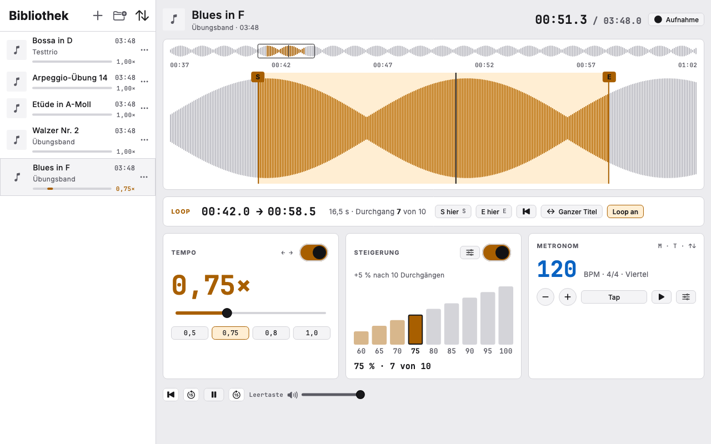
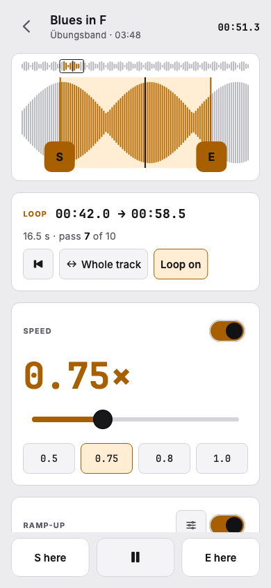

<div align="center">


# Woodshed Player

**The practice player for musicians.**<br>
Slow a track down without changing its pitch, loop the hard bars, practise with a metronome, and step up the tempo as you get better.

[**Open the web app**](https://ingen63.github.io/Woodshed-Player/app/) · [Download for macOS](https://github.com/ingen63/Woodshed-Player/releases) · [Changelog](CHANGELOG.en.md)

[](https://github.com/ingen63/Woodshed-Player/actions/workflows/test-quality.yml)
[](https://github.com/ingen63/Woodshed-Player/actions/workflows/pages.yml)
[](https://github.com/ingen63/Woodshed-Player/actions/workflows/release.yml)

**English** · [Deutsch](README.de.md)

</div>

<br>

<picture>
  <source media="(prefers-color-scheme: dark)" srcset="docs/screenshots/studio-desktop-dark.png">
  
</picture>

<table>
  <tr>
    <td width="62%">
      <picture>
        <source media="(prefers-color-scheme: dark)" srcset="docs/screenshots/studio-tablet-dark.png">
        
      </picture>
    </td>
    <td width="38%">
      <picture>
        <source media="(prefers-color-scheme: dark)" srcset="docs/screenshots/studio-phone-dark.png">
        
      </picture>
    </td>
  </tr>
</table>

<sub>English interface, made-up titles and a generated waveform. The screenshots follow your GitHub theme (light or dark).</sub>

## Why Woodshed Player?

*Woodshedding* is what musicians call practising a hard passage over and over until it sits. Woodshed Player is built for exactly that: a library of the music you are learning, and the tools to take it apart.

- 🐢 **Slower, same pitch.** Tempo from 0.1× to 2× without changing the key, with a high-quality time stretch running in a C++ audio engine.
- 🔁 **Loops that stay put.** Drag the **S** and **E** markers on the waveform, type `mm:ss.d`, or press **S** / **E** while it plays. Every track remembers its loop and tempo.
- 📈 **Speed trainer.** Start at 60 %, gain 5 % every 10 passes, end at full speed, all on its own.
- 🥁 **Metronome.** 20–300 BPM, tap tempo, 4/4, 3/4, 2/4 and 6/8, subdivisions down to sixteenths, and an automatic tempo ramp by bars or by time.
- 📚 **Library.** Folders, playlists, multi-select, drag and drop. Each file is stored once, recognised by its content. Trim the start and end of a track (WAV, FLAC, MP3, AAC, M4A).
- 🎙️ **Recording (Mac).** Record the system audio or the microphone as lossless FLAC. The recording goes straight into the library, ready to loop. Switch on **Armed** while practising and the next time you play becomes a recording of its own, filed under `Recordings › date`; it can also stay armed so that every phase of playing is recorded.
- ☁️ **Your devices, your choice.** Optional sync through your own Google Drive, using only the files the app creates itself. Without an account, nothing leaves your device.
- 🌗 **Made to practise with.** Player, Practice and Metronome areas, layouts for desktop, tablet and phone, light and dark, keyboard shortcuts everywhere (press **?** for the overview), built-in help that works offline, English and German following the system language, including the Mac menu bar and the questions the system asks.

All features in detail (in German): [`docs/FUNKTIONEN.md`](docs/FUNKTIONEN.md).

## Platforms

| | How | |
| --- | --- | --- |
| **macOS** 14+ | Native app, Apple Silicon and Intel | Recording, MP3 export and command line only here |
| **iPhone, iPad** | [Web app](https://ingen63.github.io/Woodshed-Player/app/), installable to the home screen | Works offline, lock-screen controls |
| **Android and everything else** | [Web app](https://ingen63.github.io/Woodshed-Player/app/) in the browser | No installation, no account |
| **Windows, Linux** | Coming later | Until then: the web app |

## Installation

The packages of every version are under [Releases](https://github.com/ingen63/Woodshed-Player/releases), with release notes in English and German ([`CHANGELOG.en.md`](CHANGELOG.en.md), [`CHANGELOG.md`](CHANGELOG.md)). Every package contains the license (`LICENSE`) and the license texts of the fonts and engine libraries (folder `Licenses` or `licenses`).

| Package | Platform |
| --- | --- |
| `WoodshedPlayer-<Version>-macos.dmg` | macOS 14 or later, Apple Silicon and Intel (Universal) |
| `WoodshedPlayer-<Version>-web.zip` | Web app to host yourself, the same version as <https://ingen63.github.io/Woodshed-Player/app/> |

- **macOS:** Open the `.dmg` and drag *Woodshed Player* into *Applications*. The app is only ad hoc signed and not notarized (there is no Apple Developer account). So the first time, choose **Right-click › Open** in the Finder and *Open* again in the dialog. If macOS only offers «Don't Open» or «Move to Trash», go to *System Settings › Privacy & Security* and click *Open Anyway* next to «Woodshed Player was blocked». After that it starts normally.
- **Web app:** Nothing to install, just open <https://ingen63.github.io/Woodshed-Player/app/>. To host it yourself, put the folder from the `.zip` at the root of a web server with HTTPS (or serve it on `localhost`). It only runs at the root (`/`), not in a subfolder.

## Command line (Mac)

The app doubles as a command line: play a track from the library, or arm a recording that starts with the first sound and stops by itself after a pause, so a piece played in the browser lands in the library without silence at either end.

```bash
cp tools/woodshed ~/bin/woodshed          # any folder in your PATH
woodshed play --title "Blue Practice" --artist "Test Band"
woodshed record --title "Blue Practice" --artist "Test Band" --year 1937
woodshed --help
```

The command only talks to the app on the same Mac through a socket file, never over the network. Details: [`docs/FUNKTIONEN.md`](docs/FUNKTIONEN.md) (row «Kommandozeile»).

## Privacy

Woodshed Player works **locally**.

- No account needed, no ads, no analytics, no tracking.
- No network connection, except for the sync you choose yourself (Google Drive after signing in, or your own paired devices) and loading the web app.
- Your music and your library stay in the app's private folder, or in the browser's private storage for the web app.
- The microphone is only used while you record with it or while **Armed** is on; recordings stay on your Mac.
- An automatic check on every push makes sure only the sync code may open connections.

Privacy policy: <https://ingen63.github.io/Woodshed-Player/datenschutz.html> · Terms of use: <https://ingen63.github.io/Woodshed-Player/nutzungsbedingungen.html> · All details (in German): [`docs/FUNKTIONEN.md`](docs/FUNKTIONEN.md#datenschutz-im-detail)

## Under the hood

- **App:** [Flutter](https://flutter.dev) for macOS, iOS and the web, in [`app/`](app/).
- **Audio engine:** C++17 in [`core/`](core/) with a C API, with [miniaudio](https://miniaud.io), [Signalsmith Stretch](https://signalsmith-audio.co.uk/code/stretch/) and libFLAC. Natively through `dart:ffi`, in the browser as WebAssembly in an AudioWorklet.
- **Tested hard:** unit and UI tests, sanitizers, coverage limits, mutation testing, and a check that the WASM build behaves exactly like the native one. See [`docs/TESTS.md`](docs/TESTS.md).
- **Older version:** the original SwiftUI app lives on in [`WoodshedPlayer/`](WoodshedPlayer/).

## Contributing

Requirements come from [GitHub Issues](https://github.com/ingen63/Woodshed-Player/issues), each with acceptance criteria as a checklist. Building, testing, the technical details and the release process are described in [`docs/ENTWICKLUNG.md`](docs/ENTWICKLUNG.md), the working rules in [`CLAUDE.md`](CLAUDE.md) (both in German). Please report security issues as described in [`SECURITY.md`](SECURITY.md).

## License

The source code and the app icon ([source](app/assets/icons/README.md)) are under the [MIT License](LICENSE). The name “Woodshed Player” is not covered by it.

The fonts Inter and JetBrains Mono are under the [SIL Open Font License 1.1](app/assets/fonts/README.md). The audio engine contains miniaudio (Public Domain or MIT-0), Signalsmith Stretch and Signalsmith Linear (MIT) and libFLAC (BSD-3-Clause). The MP3 export on the Mac loads **LAME** (LGPL) as a separate, replaceable library. Versions, sources and license texts: [`docs/ENTWICKLUNG.md`](docs/ENTWICKLUNG.md#lizenzen-im-detail), and in the app under *About Woodshed Player › View licenses*.
