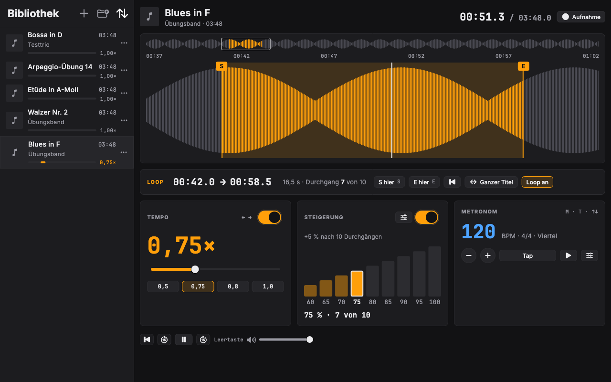
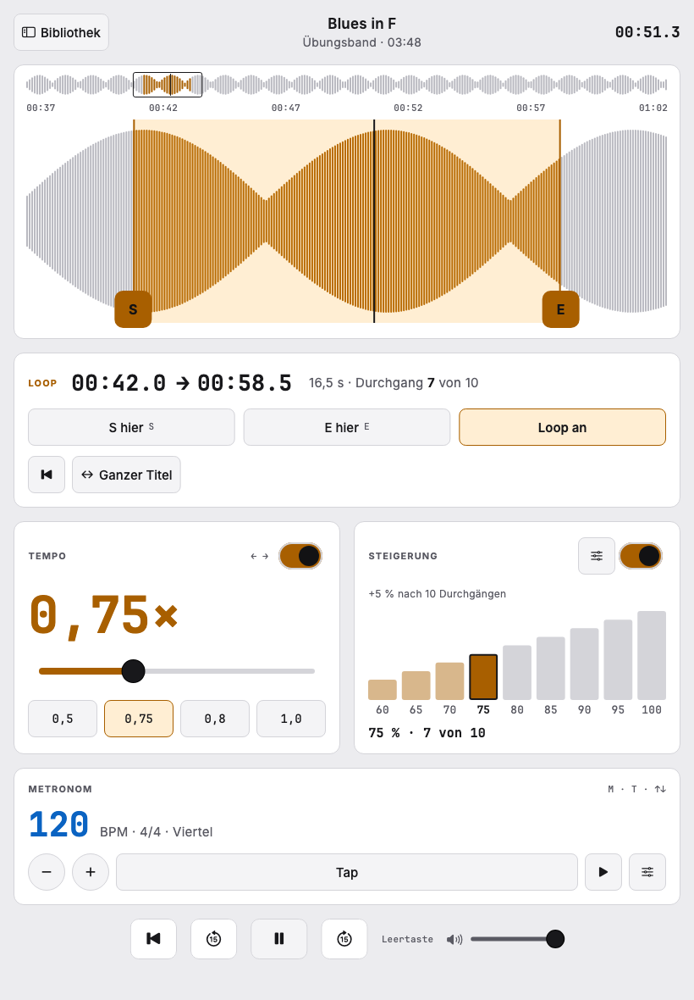

# Woodshed Player

Native SwiftUI-App für **macOS 14+** und **iOS/iPadOS 17+** aus einer gemeinsamen Codebasis.

## Starten

1. **Xcode** aus dem Mac App Store installieren (Version 16 oder neuer) und einmal öffnen.
2. `WoodshedPlayer.xcodeproj` öffnen.
3. Target *WoodshedPlayer* → *Signing & Capabilities* → unter *Team* deine Apple-ID wählen.
   Falls die Bundle-ID `ch.woodshed-player-app.legacy` schon vergeben ist, dort ändern.
4. Oben in der Leiste als Ziel **My Mac** oder einen iPhone-Simulator/dein iPhone wählen → **⌘R**.

## Funktionen

| Funktion | Bedienung |
| --- | --- |
| MP3 hinzufügen | **+** in der Symbolleiste (⌘O), auf dem Mac auch Dateien in die Liste ziehen |
| MP3 löschen | Rechtsklick → *Löschen*, auf dem Mac auch Entf-Taste, auf iOS wischen oder *Bearbeiten* |
| Ordner | Ordner-Symbol in der Symbolleiste (⇧⌘N) legt einen Ordner an. Titel mit der Maus auf einen Ordner (oder zwischen dessen Titel) ziehen oder per Rechtsklick → *In Ordner verschieben*. Rechtsklick auf einen Ordner: *MP3 hinzufügen*, *Umbenennen*, *Ordner löschen* (die Titel bleiben erhalten) |
| Sortierung | Pfeil-Symbol → *Alphabetisch*, *Hinzugefügt* (neueste zuerst), *Eigene Reihenfolge* |
| Eigene Reihenfolge | Titel innerhalb eines Ordners mit der Maus (bzw. dem Finger) verschieben, die Sortierung wechselt dann automatisch auf *Eigene Reihenfolge* |
| Abspielen | Play/Pause (**Leertaste**), ±15 s, Fortschrittsbalken zum Springen, Lautstärke. Stoppt man mit der Leertaste bei aktivem Loop, springt die Position zum Loop-Anfang zurück |
| Geschwindigkeit | Schalter *Geschwindigkeit*, Regler 0,1× – 2× in 0,05er-Schritten, Pfeiltasten **←** / **→**, Schnellwahl 0,5× / 0,7× / 0,8× / 0,9× / 1,0× / 1,1×. Die Tonhöhe bleibt gleich |
| Loop | Schalter *Loop*, Anfang/Ende als `mm:ss` (z. B. `01:23` – `02:11`), per *Aktuelle Position*, mit den Tasten **S** (Anfang) / **E** (Ende) oder durch Ziehen der orangen Marker im Fortschrittsbalken (die Zeitfelder zeigen dabei live die Position). Das Ende liegt immer mindestens 1 s nach dem Anfang |

Geschwindigkeit und Loop werden **pro Datei** gespeichert und beim nächsten Öffnen wiederhergestellt.

### Flutter-App (im Umbau, `app/`)

Die neue App für alle Plattformen (Plan: `docs/UMBAUPLAN-FLUTTER.md`) hat dieselbe Bibliothek wie die bisherige App und das Design «Studio» (Mockups in `docs/design/`): Wellenform mit Loop-Bereich im Zentrum, Loop und Tempo grösser als Play/Pause, Zahlen in JetBrains Mono mit gleich breiten Ziffern, Text in Inter. Hell oder Dunkel ist im Kopf der Bibliothek wählbar, Standard ist die Systemeinstellung.

| Desktop (> 1000 px) | Tablet (600–1000 px) | Phone (< 600 px) |
| --- | --- | --- |
|  |  |  |
|  |  |  |

Die Screenshots zeigen die englische Oberfläche mit erfundenen Titeln und einer erzeugten Wellenform; sie entstehen unabhängig von der Systemsprache (`cd app && flutter test tool/screenshots_test.dart --update-goldens`).

| Funktion | Bedienung |
| --- | --- |
| Plattformen | **macOS, Windows, Linux:** native Flutter-App (Windows und Linux folgen). **iPhone/iPad:** native App und Web-App. **Android und alle anderen Geräte:** Web-App im Browser, ohne Installation und ohne Konto; eine native Android-App gibt es nicht. Die Aufnahme gibt es nur am Mac |
| Web-App (#41) | <https://ingen63.github.io/Woodshed-Player/app/>, auch über «App öffnen» auf der Startseite. Gehostet auf **GitHub Pages**; eine GitHub-Action baut sie aus dem letzten Git-Tag (vorher laufen die Tests), neue App-Stände erscheinen also nur mit einem neuen Tag. Ein Service Worker setzt die Header COOP/COEP, damit der Browser die Seite isoliert und `SharedArrayBuffer` bereitstellt |
| Web-App am Handy (#39) | **Installierbar** (Manifest und Icons): auf dem iPhone/iPad über *Teilen › Zum Home-Bildschirm*, worauf ein schliessbarer Hinweis oben hinweist, solange die App im Browser läuft; einmal geschlossen, bleibt er auf diesem Gerät und in diesem Browser weg (#110); auf Android über das Menü des Browsers. **Startet offline:** Der Service Worker legt die App beim ersten Besuch in den Cache; ein neuer Stand ersetzt den alten Cache beim nächsten Start mit Verbindung. **Sperrbildschirm und Kopfhörertasten** (Media Session): Titel und Artist, Abspielen, Pause, Springen (±15 s) und Position. Der Aufnahme-Knopf ist im Browser nie sichtbar. **Audio-Cache** (mit Abgleich): Die Audiodateien auf dem Gerät haben eine Obergrenze (Standard 2 GB, nur für dieses Gerät); Tippen auf die Speicherzeile im Fuss der Bibliothek stellt sie ein. Darüber verlieren die am längsten nicht gespielten Titel ihre Datei auf dem Gerät, sofern sie in der Cloud liegt; sie bleiben in der Bibliothek, stehen mit «Nur in der Cloud» in der Liste und werden beim Abspielen wieder geladen. *Offline halten* im Kontextmenü schützt einen Titel davor, ebenso der gerade geladene |
| Grössen | Das Layout richtet sich nach der Fensterbreite und wechselt ohne Unterbruch von Wiedergabe oder Loop. **Desktop:** Bibliothek fest links, darunter Wellenform, Loop-Leiste und die Module Tempo, Steigerung und Metronom nebeneinander. **Tablet:** Bibliothek über den Knopf «Bibliothek» einblendbar, Module zweispaltig. **Phone:** Bibliothek als eigene Seite (Leiste unten öffnet den Übe-Bildschirm, «‹» führt zurück), einspaltig, *S hier* / Play / *E hier* unten in Daumenreichweite. Auf Tablet und Phone sind alle Bedienelemente mindestens 44 × 44 pt (iOS) bzw. 48 × 48 dp (Android) gross |
| Wellenform | Oben die Übersicht des ganzen Titels (Tippen springt, der Rahmen zeigt den Ausschnitt), darunter der Ausschnitt um den Loop bzw. die 30 Sekunden um die Wiedergabeposition, mit Zeitachse und Playhead. Solange keine Wellenform da ist, erscheint ein schlichter Fortschrittsbalken |
| Loop | Leiste «LOOP» mit «Anfang → Ende» als `mm:ss.d` (beide Zeiten lassen sich eintippen), Länge und Durchgangszähler, *S hier* / *E hier* (Tasten **S** / **E**), *Zum Loop-Anfang*, *Ganzer Titel* und *Loop an/aus*. Die Marker **S** und **E** in der Wellenform lassen sich ziehen |
| Tempo | Grösste Zahl auf dem Bildschirm, Schalter, Regler 0,1× – 2× und Schnellwahl 0,5 / 0,75 / 0,8 / 1,0; Pfeiltasten **←** / **→**. Die Tonhöhe bleibt gleich |
| Kürzel-Badges | Neben den Knöpfen stehen die Tastenkürzel, aber nur, wenn eine Tastatur da ist (am iPad, sobald eine Taste gedrückt wurde): ⌘ auf macOS und iPad, Ctrl auf Windows und Linux |

| Funktion | Bedienung |
| --- | --- |
| Bibliothek | Titel per **⌘O** / «+» wählen (mehrere) oder ins Fenster ziehen; Ordner (**⇧⌘N**), Sortierung, Titel per Ziehen (am iPhone: lange drücken) in Ordner verschieben, Kontextmenü (Rechtsklick oder «⋯») mit *Titel und Artist bearbeiten* (#24: nur in der Bibliothek, Audiodatei und Tags bleiben unverändert, leerer Titel nicht möglich), *In Ordner verschieben* und *Löschen* mit Rückfrage. Der erste importierte Titel wird geladen. Fertige Aufnahmen landen ebenfalls hier. Jede Zeile zeigt Dauer, gespeicherten Loop als Balken und das Tempo. Ein Titel wird über den SHA-256 seines Inhalts erkannt: dieselbe Datei wird nur einmal gespeichert. Im Fuss steht der Speicherverbrauch (im Browser auch der freie Platz und ob der Speicher dauerhaft ist) |
| Metronom | Start/Stopp mit **M**, Tempo 20–300 BPM mit −/+ (gedrückt halten wiederholt), Regler oder **↑** / **↓** (mit Shift ±10), Tap-Tempo mit **T**. Taktarten 4/4, 3/4, 2/4, 6/8, Unterteilungen Viertel bis Sechzehntel, eigene Lautstärke. Ein Wechsel von Taktart oder Unterteilung wirkt sofort; kommt der laufende Schlag in der neuen Taktart nicht mehr vor, klingt er aus, und der nächste Schlag ist die betonte Eins. Modul «Metronom» mit BPM in Blau, −/+, Tap und Start/Stopp; alle Einstellungen über das Regler-Symbol (Dialog, am Phone von unten). Titel und Metronom laufen nie gleichzeitig (Start des einen pausiert den anderen). Nach einem Neustart gilt 120 BPM, die übrigen Einstellungen bleiben erhalten |
| Automatische Tempo-Steigerung | Wahlweise nach «Takte» oder «Zeit». Takte: Start- und Ziel-BPM, Schritt und alle wie viele Takte; ist das Ziel erreicht, geht es nach gleich vielen Takten wieder beim Start-BPM los. Zeit: Start- und Ziel-BPM und Dauer (1–60 Minuten, Standard 4); das Tempo ändert sich in 1-BPM-Schritten gleichmässig über die Dauer, jeweils am Taktanfang, bleibt nach Erreichen des Ziels einen Schritt lang und beginnt dann wieder beim Start-BPM |
| Steigerung nach Durchgängen | Modul «Steigerung» mit Stufenleiter (erreichte Stufen gedämpft, aktuelle umrandet), die Einstellungen öffnet das Regler-Symbol. Die Geschwindigkeit des Titels steigt stufenweise mit der Zahl der Loop-Durchgänge, einstellbar sind Start- und Zielstufe, Schrittweite (+1 bis +20 %) und Durchgänge pro Stufe (Standard 60 % → 100 %, +5 % alle 10 Durchgänge). Ein Durchgang zählt, wenn die Wiedergabe vom Loop-Ende zum Anfang springt, Springen von Hand nicht. Angezeigt werden Stufe und Durchgänge, z. B. «75 % · 7 von 10»; am Ziel bleibt die Geschwindigkeit, der Zähler läuft weiter. Loop-Grenzen oder Geschwindigkeit von Hand ändern setzt den Zähler auf 0. Gespeichert pro Titel |
| Gerätewechsel | Wird die Ausgabe gewechselt (z. B. Kopfhörer ab) oder kommt ein Anruf dazwischen, pausieren Titel und Metronom; die Position bleibt. Weiter geht es mit Play |
| Aufnahme (nur Mac, ab macOS 14.2) | Übungsmitschnitt: Knopf «Aufnahme» oben rechts startet und stoppt (auf iPhone/iPad, Android und im Browser nie sichtbar). Nimmt den Systemton auf (Core Audio Process Tap), ohne Mikrofon. Der eigene Player-Ton und das Metronom sind ausgenommen, damit nichts doppelt im Mitschnitt landet. Während der Aufnahme zeigt der Knopf Dauer und Pegel. Beim ersten Mal fragt macOS nach der Berechtigung; kommt nur Stille an (z. B. weil sie verweigert wurde), nennt ein Hinweis den Ort *Systemeinstellungen › Datenschutz & Sicherheit › Bildschirm- & Systemaudioaufnahme*. Nach dem Stopp liegt die Aufnahme als neuer Titel in der Bibliothek, benannt nach Datum und Uhrzeit im Format der Systemsprache (z. B. «Aufnahme 19.11.2026 14:05:09»), umbenennbar und mit Tempo und Loop abspielbar |
| Darstellung | Knopf im Kopf der Bibliothek (Symbol Auto, Sonne oder Mond) mit *System*, *Hell* und *Dunkel*, auch im Phone-Layout. *Hell* und *Dunkel* gelten sofort und unabhängig von der Systemeinstellung, *System* folgt ihr auch bei laufender App. Die Wahl ist wie die Sortierung eine geteilte Einstellung in `library.json` und bleibt nach einem Neustart erhalten; fehlt sie oder ist sie unlesbar, gilt *System* |
| Bibliothek und Datenformat (#36) | `library.json` hat ab Format 2 eine Versionsnummer, je geteiltem Feld einen Änderungsstempel (Zeit, Zähler, Gerät-ID) und hält gelöschte Titel und Ordner 90 Tage als Grabstein, damit sich später Änderungen mehrerer Geräte zusammenführen lassen (#37). Danach merkt sie sich, bis wann bereinigt wurde: Ein Gerät, das länger offline war, bringt gelöschte Titel und Ordner nicht zurück; was es selbst vor diesem Zeitpunkt zuletzt geändert und nie abgeglichen hat, gilt dann ebenfalls als gelöscht. Das gilt erst ab dem ersten Abgleich eines Geräts: Beim ersten Abgleich bleiben alle eigenen Titel und Ordner mit ihren Audiodateien erhalten (#104). Ein erneuter Import belebt einen Titel wieder (#98). Eine ältere Bibliothek wird beim ersten Start überführt: Titel-ID wird der SHA-256 der Audiodatei, die Dateien in `Tracks/` heissen danach `<hash>.<ext>`, Loops, Tempo, Ordner und Einstellungen bleiben erhalten. Die alte Datei bleibt als `library.v1.json`, die Zuordnung alte ID → Hash als `library.v1-ids.json`. Danach kann das Swift-Altprojekt die Bibliothek **nicht mehr öffnen**. Ist `library.json` von einer neueren App-Version, bleibt sie unverändert und die App bittet, sich zu aktualisieren |
| Abgleich zwischen Geräten (#37, #53) | Die Sync-Engine gleicht Bibliothek, geteilte Einstellungen und Audiodateien ab, sobald Du einen Weg gewählt hast: **Google Drive** (#54) oder **OneDrive** (#55) mit Konto, oder die **direkte Verbindung** zwischen Deinen gekoppelten Geräten ohne Konto (#56); diese drei Wege folgen noch. **Ohne Konto bleibt alles lokal.** Zusammengeführt wird je Feld (jüngere Änderung gewinnt), Loops einzeln über ihre Loop-ID, gelöschte Titel und Ordner über Grabsteine. Abgeglichen wird beim Start, bei der Rückkehr in den Vordergrund und kurz nach einer Änderung; ohne Verbindung warten die Änderungen und gehen später mit wachsendem Abstand erneut raus, eine Datei, die mehrmals scheitert, wird nicht endlos wiederholt. Im Kontextmenü: *Nicht hochladen* (Titel) und *Synchronisieren* (Ordner, Standard an); die Audiodatei bleibt dann auf dem Gerät, Titel, Loops und Tempo wandern trotzdem mit. Auf anderen Geräten steht solch ein Titel mit «Datei nur auf einem Gerät». Am Desktop kommen Audiodateien gleich mit, auf Handy und im Browser erst beim Abspielen. **Eine Datei je Gerät** (#53): In der Cloud liegen `format.json` (Format-Version und Bibliotheks-ID), je Gerät `devices/<geraet-id>.json`, die nur dieses Gerät schreibt, seine letzten 5 Stände unter `backup/<geraet-id>/` und die Audiodateien als `audio/<hash>.<ext>`. Jedes Gerät liest alle Gerätedateien, führt sie zusammen und schreibt das Ergebnis in seine eigene; bedingtes Schreiben braucht der Speicher dafür nicht. Ein Gerät kann mit mehreren Quellen abgleichen (Cloud und gekoppelte Geräte) und so Änderungen zwischen ihnen weitertragen (Brücke). Konfliktkopien einer Gerätedatei, wie sie Speicher anlegen (z. B. `… (1).json` oder mit Gerätename), werden zusammengeführt und entfernt, die Datei eines Geräts, das 180 Tage nicht geschrieben hat, ebenso. Eine unlesbare Gerätedatei oder eine Audiodatei mit falschem Hash wird ohne Fehlermeldung übersprungen und später erneut versucht. Steht in `format.json` eine neuere Version, schreibt die App nichts und bittet, sich zu aktualisieren; eine fremde Bibliotheks-ID wird nicht zusammengeführt. Die Daten auf dem Gerät bleiben in allen Fällen unverändert (#10). Den Dialog zum Reparieren einer beschädigten `state.json` (#65) braucht es seither nicht mehr. Ein neues Gerät überschreibt die auf den anderen Geräten gewählte Sortierung und Darstellung nicht mit seinen Standardwerten |
| Sprache | Die Oberfläche folgt der Systemsprache: Deutsch oder Englisch, bei jeder anderen Sprache Englisch. Zahlen und Grössen stehen in der Schreibweise der Sprache (z. B. «0,75×» und «1,2 GB» auf Deutsch, «0.75×» und «1.2 GB» auf Englisch); Zeiten `mm:ss` sind überall gleich |
| Über Woodshed Player (#50) | Knopf «i» im Kopf der Bibliothek, auf dem Mac zusätzlich im App-Menü: Version, Git-Tag des Builds (ohne Tag «Ohne Tag»), Build-Datum in der Schreibweise der Sprache, Lizenz und Links zu Datenschutzerklärung, Nutzungsbedingungen und Quelltext. Die Links öffnen im Browser; die App selbst lädt nichts aus dem Netz. Darunter *Lizenzen ansehen* mit den Lizenzen der Pakete und Schriften |

## Technik

- `Audio/AudioPlayer.swift`: `AVAudioEngine` → `AVAudioPlayerNode` → `AVAudioUnitTimePitch`.
  Die Geschwindigkeit ändert sich ohne Tonhöhenänderung. Loops werden als sich wiederholende Segmente geplant (lückenlos).
- `Model/Library.swift`: Importierte Dateien werden in den App-Ordner kopiert (*Application Support/WoodshedPlayer*).
  Metadaten und Einstellungen liegen in `library.json`.
- `Views/PlayerKeyboardShortcuts.swift`: Tastatursteuerung. Beim Tippen in Textfeldern ist sie aus.
- `Views/`: SwiftUI-Oberfläche, angelehnt an die macOS-Schnellansicht.
- `WoodshedPlayerTests/`: Tests (Swift Testing) für Zeitformat, Loop-Grenzen und `library.json`. Testaudio wird im Test erzeugt.
  Ausführen mit ⌘U in Xcode oder `xcodebuild -project WoodshedPlayer.xcodeproj -scheme WoodshedPlayer -destination 'platform=macOS' test`.
- Auf iOS läuft die Wiedergabe auch im Hintergrund weiter (Background Mode *Audio*).
- `core/` (Flutter-App): Audio-Kern in C++ mit C-API `core/include/wp_core.h` (miniaudio, Signalsmith Stretch).
  Steuerbefehle erreichen den Audio-Thread über eine Lock-free-Queue, Titel werden im Hintergrund dekodiert,
  Ladefehler kommen mit Code und englischem Text für Logs (`wp_error_message`); die Oberfläche zeigt je Code den übersetzten Text aus den ARB-Dateien. Tests mit `ctest`, Testaudio aus `core/tools/make_test_audio.sh`.
- Tests und Code-Hygiene (#7): Teststrategie und Testmatrix in `docs/TESTS.md`. `make test` (Kern mit `ctest`, App mit `flutter test`), `make format-check` (`dart format`, `clang-format`) und `make lint` (strenge Dart-Analyse, C++ mit `-Wall -Wextra -Werror`, `clang-tidy`, `actionlint` für die GitHub-Workflows); Entwicklerwerkzeuge aus Homebrew `llvm` und `actionlint`.
- Testabdeckung (#8): `make coverage` misst die Zeilenabdeckung getrennt für den C++-Kern (`llvm-cov`) und die Dart-Logik (`flutter test --coverage`); jeder Teil muss die Untergrenze aus `tools/coverage-min` (80 %) erreichen. `make coverage-diff` zeigt die Abdeckung der seit `BASE` (Vorgabe `origin/main`) geänderten Zeilen. Vor jedem Push prüft der Hook `tools/git-hooks/pre-push` Tests und Abdeckung; einrichten einmal je Klon mit `git config core.hooksPath tools/git-hooks`. Einzelheiten in `docs/TESTS.md`.
- Sanitizer und Echtzeitsicherheit (#57): `make sanitize` testet den Kern mit AddressSanitizer und UndefinedBehaviorSanitizer, `make sanitize-thread` mit ThreadSanitizer, `make test-core-debug` in einem Debug-Build; jeder Fund lässt den Lauf scheitern. Der Workflow `test-quality.yml` führt ASan/UBSan bei jedem Push mit Änderung in `core/` aus und TSan nächtlich (Linux). `realtime_tests` prüft, dass der Render-Pfad keinen Speicher anfordert und nicht sperrt. Einzelheiten in `docs/TESTS.md`.
- Netzwerkfreiheit (#58): `make network-free` (Prüfung `app/tool/network_free.dart` mit eigenen Tests, dazu der Test «ohne Konto kein `HttpClient`») läuft im Workflow `test-quality.yml` bei jedem Push. Netzwerkcode gehört nach `app/lib/sync/providers/`. Einzelheiten in `docs/TESTS.md`.
- Oberflächentests und Workflow (#13): `make test-ui` (Start, Import, Play/Pause, Loop, Tempo, Tastenkürzel und Pseudo-Sprache mit echtem Kern auf macOS), `make test-web` (OPFS und WASM-Kern in Chrome), `make smoke-app` (gebaute App startet, spielt eine erzeugte Datei und endet mit Code 0). Der Workflow `test-quality.yml` prüft Format, Lint, Tests und Abdeckung bei jedem Push mit Code-Änderung auf Linux, die Web-Tests bei Web-Änderungen, den Vertrag nativ ↔ WASM bei Änderungen am Kern (#77) und nächtlich macOS/iOS-Build, Oberflächentests und Rauchtest. Einzelheiten und Minutenverbrauch in `docs/TESTS.md`.
- Leistungs- und Lasttests (#59): `make bench` misst den Time-Stretch je Puffer (0,1× bis 2×, Grenze 50 % des Echtzeitbudgets), lädt, zeichnet und rendert eine erzeugte 60-Minuten-Datei mit Speichergrenze und prüft eine Bibliothek mit 10'000 erfundenen Titeln in 500 Ordnern (Laden, Sortieren, Speichern je ≤ 1 s, Zusammenführen ≤ 2 s). Nächtlich im Workflow, nicht in `make test`; Messwerte in `docs/TESTS.md`.
- Mutationstests (#11): `make mutants` verändert den C++-Kern mit Mull (Apache-2.0, nur Werkzeug) und die Dart-Logik mit einem eigenen Werkzeug an je einer Stelle und prüft, ob ein Test es merkt; `make mutants-diff` nur die seit `BASE` geänderten Zeilen, vor dem Push durch den `test-agent` und nächtlich im Workflow. Zeitlimit je Mutant, Speichergrenze je Testprozess, höchstens 4 Mutanten gleichzeitig; nicht erkannte Mutanten bekommen einen Test oder einen begründeten Ausschluss (`tools/mutants-exclude.txt`). Einzelheiten in `docs/TESTS.md`.
- Übersichtsseite Testqualität (#12): `make report` schreibt `local/test-quality/report/index.html` (offline, nicht eingecheckt) aus JUnit von `ctest` und `flutter test`, Abdeckung, Mutationsläufen und, nur beim Erzeugen, den Issues über `gh`: vier Schichten (Hygiene, Angemessenheit, Anforderungsbezug, Ergebnis) mit je eigenem Status, ohne Gesamtnote, und ein Verlauf gegenüber der vorherigen Version. Der Workflow `test-quality.yml` lädt sie als Artefakt hoch. Einzelheiten in `docs/TESTS.md`.
- `app/` (Flutter-App): `lib/library/` (`library.json` im Format 2 mit Stempeln, `stamps.dart` mit Zusammenführen je Feld, `migration.dart` für das alte Swift-kompatible Format, eigener Metadaten-Leser für ID3/FLAC/WAV), `lib/player/` (Player-Service über FFI), `lib/app/` (Zusammenspiel, Dateiauswahl), `lib/ui/`. Oberflächentests mit echtem Kern: `make test-ui`.
- `core/web/`: Kern fürs Web (#33): `emcmake cmake -S core -B core/build-wasm` baut `wp_core_web.wasm` fürs AudioWorklet (C-API wie `wp_core.h`, ergänzt um `wp_core_web.h`) und lässt dieselben `ctest`-Fälle unter Node.js laufen. MP3, WAV und FLAC dekodiert der Kern, AAC/M4A der Browser (`decodeAudioData`). JS-Hülle `wp_core_web.mjs`, Worklet `wp_worklet.js`, Worker `wp_loader.js` (#42: dekodiert mit einer zweiten Instanz des Kerns, damit Wiedergabe und Metronom beim Laden nicht aussetzen), Browser-Test `browser_test.html`.
- Flutter-App im Browser (#34): `AudioCore` hat zwei Implementierungen, per bedingtem Import gewählt: FFI auf Desktop und Handy, im Browser der WASM-Kern im AudioWorklet (`app/lib/player/audio_core_web.dart`, Steuerung und Zustand als Nachrichten). Bau: `app/tool/build_web_core.sh`, dann `cd app && flutter build web`. Prüfung im Browser: `app/tool/web_core_check.sh` (misst Position, Pegel, Wellenform, Tempo, Loop, Seek, Metronom, dazu #42: Laden ohne Aussetzer, Formate, Dauer in der Bibliothek).
- Offline-Start (#39): Nach `flutter build web` schreibt `dart run tool/stamp_sw.dart build/web` (in `app/`) die Version des Builds (Hash über alle Dateien) und die Liste der Dateien für den Cache in `build/web/sw.js`; Pages-Workflow und `make test-web-start` tun das selbst. Ohne Stempel (z. B. `flutter run`) lädt der Service Worker immer zuerst aus dem Netz.
- Speicher-Schicht (#35): `FileStore` in `app/lib/app/file_platform.dart`, im Dateisystem (`file_store_io.dart`, Desktop und Handy) und im Origin Private File System des Browsers (`file_store_web.dart`). Seit #36 ist der SHA-256 die Titel-ID; dieselbe Migration läuft im Dateisystem und im Browser. Prüfung im Browser: `app/tool/web_store_check.sh`.
- Sprachen (#43): Alle Oberflächentexte stehen in `app/lib/l10n/app_en.arb` (Vorlage, Englisch) und `app_de.arb`; Flutter `gen-l10n` erzeugt daraus `AppLocalizations` (Einstellungen in `app/l10n.yaml`). Eine weitere Sprache braucht nur eine zusätzliche Datei `app_<code>.arb`. Ein Test prüft, dass jeder Schlüssel in allen Dateien vorkommt.
- `web/w0/`: Machbarkeitstest für die Web-App (#32): Engine und Metronom als WebAssembly im AudioWorklet (`core/web/build_w0.sh`, Prüfung mit `node core/web/w0_test.mjs`). Ergebnis in `docs/PLAN-WEB-UND-SYNC.md`.
- Build-Infos (#50): Ein Build-Schritt der macOS- und iOS-Projekte (`app/tool/stamp_build_info.sh`) schreibt bei jedem Bauen den letzten Git-Tag (`git describe --tags --abbrev=0`) und das Datum (UTC) als `WPGitTag` und `WPBuildDate` ins Info.plist; der Info-Dialog liest sie über den Kanal `woodshed/files`. Im Browser kommen sie aus `--dart-define=WP_GIT_TAG=… --dart-define=WP_BUILD_DATE=JJJJ-MM-TT`.
- Öffentliche Seiten (#50): `.github/workflows/pages.yml` baut mit `site/build_site.py` (nur Python-Standardbibliothek) die Startseite `site/index.html`, die Datenschutzerklärung und die Nutzungsbedingungen aus `docs/DATENSCHUTZ.md` und `docs/NUTZUNGSBEDINGUNGEN.md` und legt die W0-Testseite unter `w0/` dazu. Seit #41 läuft er bei jedem Push auf `main`; ein Tag `v*` startet ihn auf `main` neu (die Umgebung `github-pages` lässt nur `main` veröffentlichen). Er sucht den letzten Tag (`git describe --tags --abbrev=0`), baut aus diesem Stand den WASM-Kern (`app/tool/build_web_core.sh`, Emscripten), prüft ihn unter Node.js, führt `flutter test` aus und baut die Web-App mit `--base-href /Woodshed-Player/app/` nach `app/` (`build_site.py … --app <Ordner>`). Gibt es keinen Tag, fehlen App und Knopf «App öffnen». Name, Anschrift und Kontakt-E-Mail der verantwortlichen Person stehen nicht im Repository, sondern als Platzhalter; der Workflow setzt sie aus den Repository-Secrets **`CONTROLLER_NAME`**, **`CONTROLLER_ADDRESS`** (eine Zeile, z. B. «Strasse 1, PLZ Ort, Land») und **`CONTACT_EMAIL`** ein (*Settings › Secrets and variables › Actions*). Fehlt ein Secret oder bleibt ein Platzhalter stehen, bricht er ab. Lokal: `CONTROLLER_NAME=… CONTROLLER_ADDRESS=… CONTACT_EMAIL=… python3 site/build_site.py _site`.

## Datenschutz

Datenschutzerklärung: <https://ingen63.github.io/Woodshed-Player/datenschutz.html> · Nutzungsbedingungen: <https://ingen63.github.io/Woodshed-Player/nutzungsbedingungen.html> (Quelle: [`docs/DATENSCHUTZ.md`](docs/DATENSCHUTZ.md), [`docs/NUTZUNGSBEDINGUNGEN.md`](docs/NUTZUNGSBEDINGUNGEN.md)).

Woodshed Player arbeitet **lokal**:

- Keine Netzwerkverbindungen ausser dem freiwilligen Abgleich (siehe unten) und dem Laden der Web-App, kein Konto nötig, keine Werbung.
- Keine Analyse- oder Tracking-Dienste, keine Weitergabe von Daten an Dritte.
- Importierte MP3-Dateien werden in den privaten App-Ordner kopiert. Titel, Künstler, Album, Cover sowie Tempo- und Loop-Einstellungen werden nur dort (`library.json`) und in den lokalen App-Einstellungen gespeichert.
- Die App läuft in der macOS-App-Sandbox und liest nur Dateien, die du selbst auswählst.
- Flutter-App: Geteilte Einstellungen (Sortierung, Darstellung, Metronom- und Steigerungs-Voreinstellungen) liegen mit der Bibliothek in `library.json`, ein früheres `metronome.json` wird einmal übernommen. Gerätelokal ist `device.json` mit einer zufälligen Gerät-ID (keine Hardware-Kennung) und der Angabe, ob das Gerät schon abgeglichen hat; im Browser dazu die Cache-Grenze und ob der Hinweis «Zum Home-Bildschirm» geschlossen wurde. Die Gerät-ID steht in den Änderungsstempeln und verlässt das Gerät nur mit dem Cloud-Sync. Dateipfade werden nicht gespeichert. Aufnahmen des Systemtons (Mac) werden nur lokal im App-Ordner gespeichert; die Aufnahme startet nur auf Knopfdruck.
- Cloud-Sync (#37): **ohne Konto keine Verbindung.** Ohne Konto benutzt die App `NoSync`, sendet keine Anfrage und lädt kein Anbieter-Modul. Erst nach ausdrücklicher Anmeldung bei **Google Drive** (#54, nur Dateien, die die App selbst anlegt: `drive.file`) oder **OneDrive** (#55, App-Ordner) gehen `format.json` (Format-Version, zufällige Bibliotheks-ID), die Gerätedatei `devices/<geraet-id>.json` (Bibliothek, Loops, Tempo, geteilte Einstellungen mit Gerät-ID in den Stempeln, Zeitpunkt des Schreibens) und die Audiodateien in den app-eigenen Ordner des gewählten Anbieters, an keine anderen Stellen. Titel mit *Nicht hochladen* und Titel in Ordnern ohne *Synchronisieren* bleiben als Datei auf dem Gerät, ihre Metadaten (Titel, Artist, Loops) wandern trotzdem mit.
- Direkte Verbindung (#56): ohne Konto, nur zwischen Geräten, die Du selbst koppelst, Ende-zu-Ende verschlüsselt. Für den Verbindungsaufbau nutzt die App öffentliche Relays und STUN-Server; deren Betreiber sehen IP-Adresse und Zeitpunkt, keine Inhalte. Ohne Kopplung keine Verbindung.
- Löschst du die App (und ihren Datenordner), sind alle gespeicherten Daten weg.
- Flutter-App im Browser (#34, #35): lädt alles von der eigenen Seite (auch CanvasKit, keine Schriften von Google; die Ersatzschrift Roboto der Web-Engine ist ein Verweis auf das mitgelieferte Inter). Zeichen, die Inter nicht enthält (z. B. Chinesisch, Japanisch, Emoji), erscheinen als Ersatzzeichen (leere Kästchen): Die App liefert keine weiteren Schriften mit und lädt keine nach, offline wie online, auch nicht von der eigenen Seite (#82). Gewählte Audiodateien und die Bibliothek liegen im privaten Speicher der Seite im Browser (Origin Private File System) und verlassen das Gerät nicht. Die App bittet den Browser um dauerhaften Speicher (`navigator.storage.persist()`), damit er die Bibliothek nicht von sich aus löscht; «Websitedaten löschen» entfernt sie trotzdem.
- Automatische Prüfung (#58): `make network-free` prüft bei jedem Push, dass nur die Anbietermodule des Abgleichs (`app/lib/sync/providers/`) Verbindungen öffnen, dass kein Paket für Analyse, Absturzberichte, Werbung oder Fernkonfiguration eingebunden ist und dass der Audio-Kern keine Netzwerkaufrufe enthält. Die Web-App hat eine Content Security Policy: Verbindungen nur zur eigenen Seite und zu den API- und Anmelde-Hosts der Cloud-Anbieter.
- Hosting (#41): Startseite, Rechtstexte und Web-App liegen auf **GitHub Pages**. Beim Laden sieht GitHub die IP-Adresse, wie bei jeder Webseite. Der Service Worker der Web-App (`app/web/sw.js`) setzt nur Sicherheits-Header auf Antworten der eigenen Seite und legt die Dateien der App für den Offline-Start in den Cache des Browsers (#39); er lädt nur von der eigenen Seite und sendet nichts. Die Media Session zeigt Titel und Artist auf dem Sperrbildschirm dieses Geräts; nichts davon verlässt das Gerät.
- Testseite W0 (`web/w0/`): lädt nur ihre eigenen Dateien, sendet nichts; gewählte Audiodateien und die OPFS-Testdaten bleiben im Browser des Geräts. Beim Laden der Seite sieht der Webhost (GitHub Pages) die IP-Adresse.

## Lizenz

Der Quellcode und das App-Icon ([Quelle](app/assets/icons/README.md)) stehen unter der [MIT-Lizenz](LICENSE). Der Name „Woodshed Player“ ist davon nicht umfasst.

Die mitgelieferten Schriften Inter und JetBrains Mono stehen unter der [SIL Open Font License 1.1](app/assets/fonts/README.md) (Lizenztexte und Quellen dort, in der App unter «Über Woodshed Player» › *Lizenzen ansehen*).
